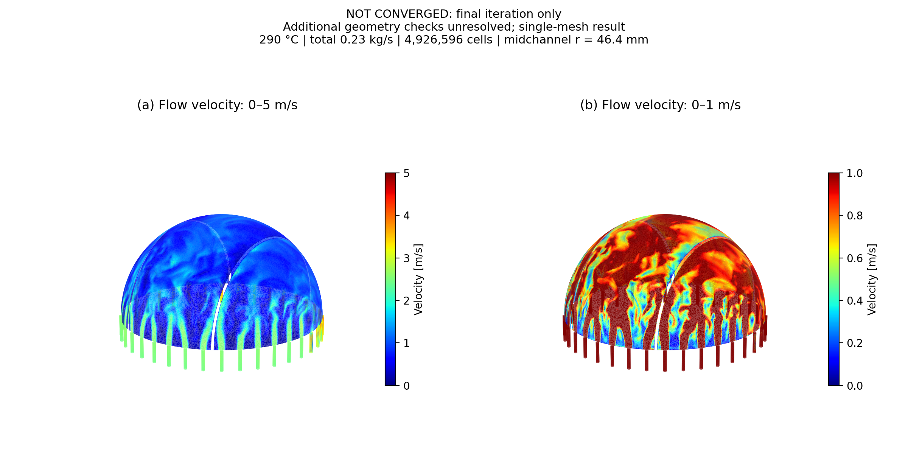

# TBM SimpleWater v01 — OpenFOAMの水流解析

**1,000反復で残差基準に未到達。未収束の参考結果です。**

新しい `Blanlet_SimpleWater_20261023_v01.step` の水領域を用いたOpenFOAM v2412の実計算です。速度分布、速度ベクトル、静圧分布を表示できます。

- [結果ZIPをダウンロード](https://github.com/miumiu031024-ship-it/TBM/raw/refs/heads/main/TBM-v01-290C-CFD.zip)
- [日本語の解析記録](tbm-v01-results/analysis-report-ja.md)
- [圧力分布図](tbm-v01-results/pressure-distribution.png) / [収束履歴](tbm-v01-results/convergence.png) / [詳細数値](tbm-v01-results/summary.json)

ZIPを展開し、中の **viewer.html** をChromeまたはEdgeで開いてください。外部通信なしで、速度の2つの色範囲を同じ角度で回転比較できます。速度ベクトルと圧力も表示します。

## 速度分布

左が0〜5 m/s、右が0〜1 m/s。色範囲を超える部分は赤く飽和します。壁面ではなく、球面水路の厚さ中央（半径46.4 mm）と管内のサンプル面から採取した計算速度です。

## 条件と解析の状態

水温290℃、実圧15.5 MPa、入口18本の合計0.23 kg/sを各管に等分、出口ゲージ圧0。目標500万セルに対し、実際の生成数は**4,926,596セル**です。独立した3つの水領域、k–ω SST、等温・非圧縮の解析です。

**定常残差が未収束で、追加メッシュ検査には小行列式セル33個・凹形状セル241個による未合格項目が残っています。研究の確定値として検証された結果ではありません。** 通常のメッシュ検査は通過していますが、良好な質量収支だけで流れ場の収束とは判断していません。格子独立性・実験比較・温度場の解析も未実施です。

最終反復の体積セル中心の最大速度は約4.222 m/s（参考値）。論文の300℃・3,600万セル・全サブモジュールとは条件と範囲が異なるため、論文との一致を示すものではありません。メッシュ品質・境界層と数値収束の改善が必要です。

元のSTEPと論文PDF、巨大な体積メッシュ・全場データは、このリポジトリや配布ZIPに含めていません。ZIPには内部サンプル面データ、条件、残差と圧力履歴、最終解法設定、検査ログを含みます。

ZIPのSHA-256：`c5916011649216da0a36788e3ab1ed5c842cab56b861c54f45216791222b2d8e`

## 以前のモデル

[旧モデルの300℃・入口15本のビューアーZIP](iter-first-wall-viewer.zip)は別の形状・条件による未収束の試計算です。今回のv01の結果と区別してください。
