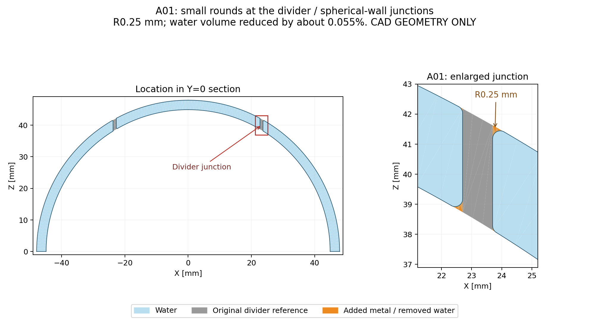
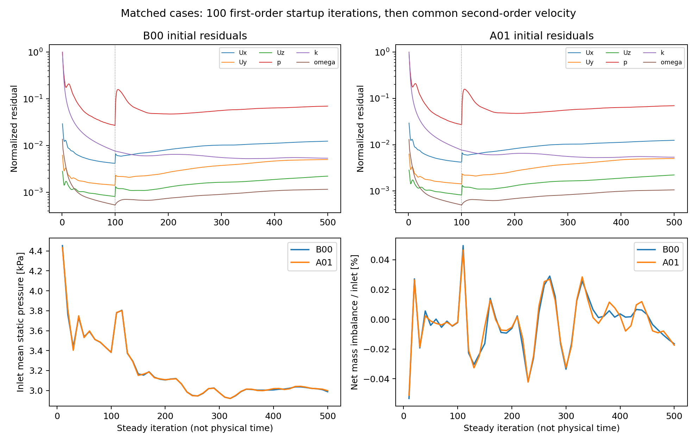
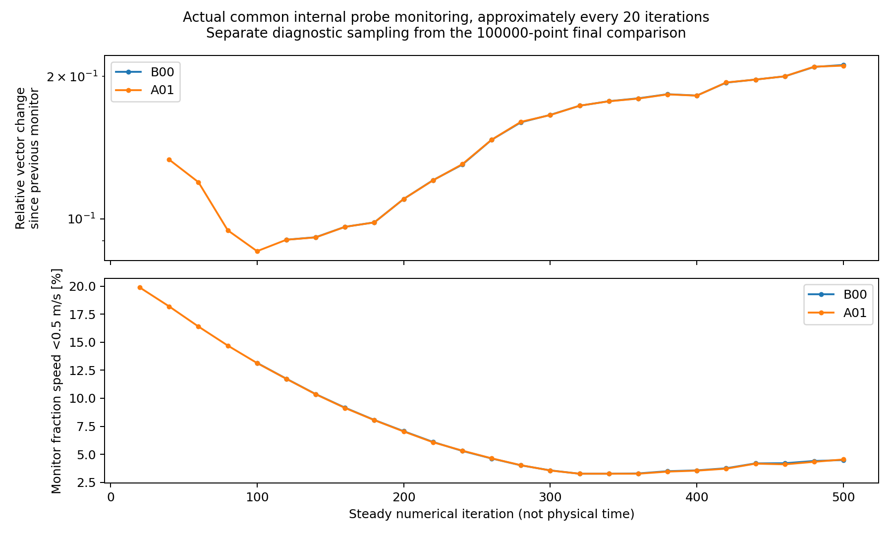
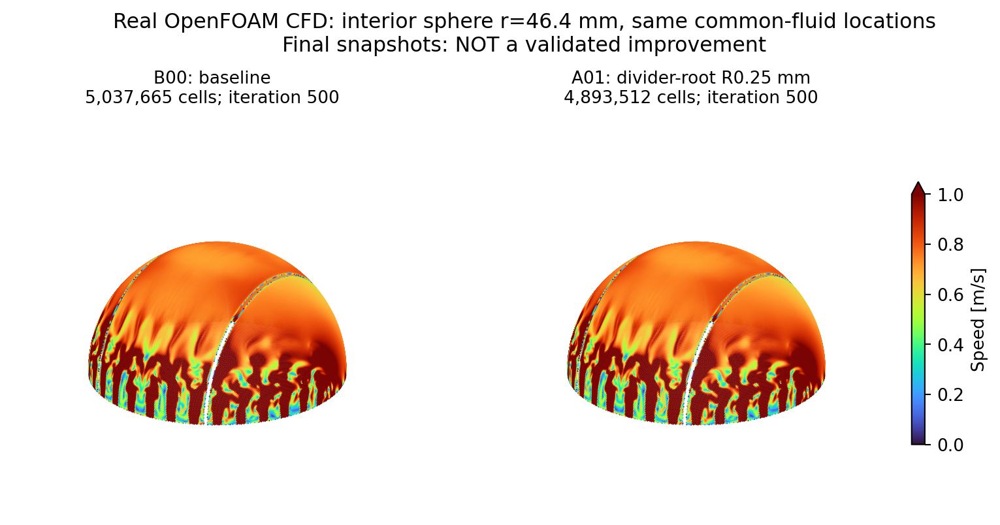
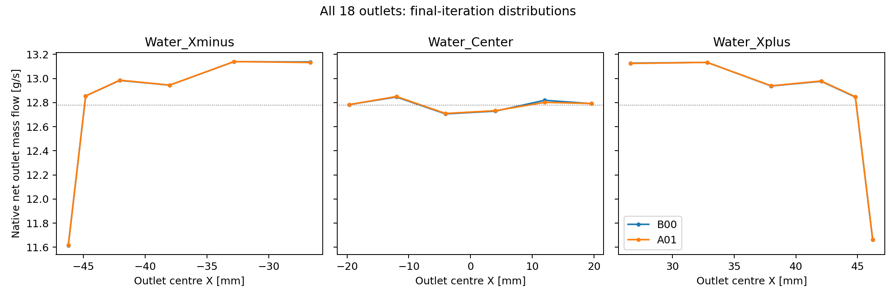

# A01（隔壁付け根R0.25 mm）：基準とのCFD比較

**A01による低速域の改善は、今回のCFDでは確認できませんでした。** 両ケースとも500反復まで実行しましたが、残差目標を満たさず、内部速度場も変化し続けています。最終反復の小さな面積差を、確定した形状効果として扱えません。

r=46.4 mmの共通内部面で、速さ0.5 m/s未満の面積は **B00 643.6 → A01 641.3 mm²（-0.36%）**でした。有効水面積に対する割合の差は **-0.0174パーセントポイント**です。一方、同じ模型の400→500反復の間に、この割合は両方で約0.98パーセントポイント変化しています。形状間の差より反復中の変化が大きく、改善の証拠にはできません。

他の共通内部面では、0.5 m/s未満の面積はr=45.2 mmで約1.19%増加、r=47.6 mmで約1.03%増加しました。しきい値や断面によらず低速域が減ったという結果でもありません。これらも未収束の参考値です。

| ケース | 内部面速度の相対L2変化（400→500） | 低速面積割合の変化・ポイント | 低速域位置のIoU |
|---|---:|---:|---:|
| B00 | 47.00% | +0.982 | 0.425 |
| A01 | 46.98% | +0.981 | 0.423 |

この表はr=46.4 mm、0.5 m/s未満の低速域について同一ケース内を比較したものです。IoUは400反復と500反復の低速点集合の共通部分÷和集合で、1なら同じ位置です。約0.42にとどまり、低速域の位置も固定していません。L2変化は相対ベクトル差であり、すべての点の速さが同じ割合で変化したという意味ではありません。

## A01で変更したもの

2枚の隔壁が内側・外側の球面壁に接する付け根を、水領域の両側からR0.25 mmで丸めました（物理的な8本の付け根曲線）。金属側に小さなすみ肉を足す形で、水領域を約23.3 mm³（約0.055%）減らしています。隔壁を短くしたり、領域間に穴を開けたりする変更ではありません。元の外形、球面内外半径44.9/47.9 mm、36管の位置・内径3 mm・直管長10 mm、3領域の分離と最小隔壁相当幅1 mmは維持しています。

対象はCFD用の水領域CADです。金属追加量は水領域の差分から説明したもので、金属製TBMの完成製作図や強度評価ではありません。[使用したA01 STEP](https://github.com/miumiu031024-ship-it/TBM/blob/main/cad-proposals-20261120/water/A01_root_R025_water.step)を参照してください。

左が球面水路のY=0断面、右が今回のA01（R0.25 mm）の拡大図です。水色が水、灰色が元の隔壁、橙色が追加する金属相当部分です。隔壁の位置や角度は変更していません。

## 実計算の条件

OpenFOAM v2412、等温・非圧縮・定常RANS k–ω SST。水290℃・実圧15.5 MPa相当の密度746.2009559 kg/m³、動粘度1.239443713e-7 m²/s。合計0.23 kg/sを18入口へ等分、18出口ゲージ圧0 Pa。これは以前の未収束結果やSTARの保存場の流用ではなく、公開したB00/A01 STEPから新規生成した計算です。

滑らかな壁、一定物性、重力なしのモデルです。圧力図はこのモデルのゲージ静圧で、実機の熱負荷・浮力・設置方向を含めた評価ではありません。

入口乱流強度5%、混合長0.21 mmを両ケースで共通にしました。ユーザーのSTARケースそのものを再現した計算ではなく、同条件での形状比較です。

同じ背景格子・表面変換の絶対許容差0.001 mm・局所細分化領域を使い、根元付近の名目セル幅約0.056 mm、主領域約0.223 mm。目標は約500万セルですが、実数は下表の通りです。メッシュは別々に生成しており、セル番号はケース間で対応しません。明示的なプリズム層はなく、壁関数を使用しています。格子独立性・熱伝達は検証していません。

100反復を一次精度で立ち上げ、その後、両ケースで速度二次精度・乱流輸送upwind、cellLimited勾配、SIMPLEC、速度/乱流量の緩和0.3・圧力0.2で計算しました。残差目標はp=1e-4、U/k/ω=1e-5。反復数を物理時間として扱いません。

## 収束と信頼範囲

| ケース | セル数 | 最終反復 | SIMPLE残差目標 | 直前保存場からの速度変化* | 入口平均静圧 kPa |
|---|---:|---:|---|---:|---:|
| B00 | 5,037,665 | 500 | 未達 | 42.08% | 2.988 |
| A01 | 4,893,512 | 500 | 未達 | 42.10% | 2.998 |

*同一ケース・同一セル番号の速度ベクトルの非体積加重相対L2変化。物理的な変動率や真の誤差ではありません。比較した反復番号は各summary.jsonに明記しています。

圧力・全体収支の監視値は10反復ごとに記録し、最終記録の反復番号を各summary.jsonのlast_recorded_monitor_iterationに記しています。

内部の別の監視点群（r=46.4 mm、約8,000点）でも20反復ごとに速度を保存しました。変化が続いているかを調べるための診断で、物理的な時間変動や時間平均ではありません。各領域別の履歴、記録開始反復、最後100反復の変化幅を各ケースのinternal-iteration-monitor*.csv/json/npzに記録しています。最終面積比較の100,000点とは点群・補間方法が異なるため、監視点の面積をそのまま最終比較値へ置き換えません。

通常・追加のcheckMesh記録を各ケースに同梱しました。密度を掛けてPaへ換算した静圧を用い、全入口の平均は実メッシュの各開口面積で重み付けしています。良い質量収支や平均圧力だけでは内部速度場の収束と判断しません。

| ケース | 追加検査の凹形状セル数 | 最大非直交角 ° | 最大スキュー |
|---|---:|---:|---:|
| B00 | 68,026 | 59.17 | 3.022 |
| A01 | 65,893 | 62.68 | 3.021 |

凹形状セルの存在だけで未収束の原因を特定したとは判断しません。一方、追加検査の未合格が残る状態では、小さな差を確定した形状改善として扱わず、格子・壁面処理の感度を確認する必要があります。

## 同じ内部断面の低速域

壁面は条件上速度0なので、球面水路の中央r=46.4 mm上の同じ100,000点を使いました。両方で水が存在する有効点の共通部分だけを比較し、等面積配置から面積を推定しています。これは壁面の速度でも、単純な画素の色面積でもありません。

| 速さのしきい値 m/s未満 | 基準の面積 mm² | A01の面積 mm² | 基準からの面積変化 |
|---|---:|---:|---:|
| 0.1 | 36.1 | 35.7 | -1.12% |
| 0.5 | 643.6 | 641.3 | -0.36% |
| 1 | 11258.5 | 11256.7 | -0.02% |

0〜1 m/sの図では1 m/sを超える値が同じ赤で飽和します。[0〜5 m/sの図](velocity-comparison-0-5.png)もあります。r=45.2/47.6 mmの内部面も[low-speed-common-area.csv](low-speed-common-area.csv)に記録しています。すべて定常計算の最終スナップショットで、物理的な時間平均ではありません。

[中央・左右を分けた低速域面積](low-speed-by-region.csv)も記録しています。ある領域の改善と別領域の悪化が相殺されていないか、全体と併せて比較します。

[速度ベクトルの比較図](velocity-vectors.png)では、同じ位置に実計算の速度ベクトルを表示しています。矢印は1 m/sを図中3 mmの長さで描いています。

[静圧分布の比較図](pressure-comparison.png)も同じ内部球面・共通の色範囲で表示しています。単位はゲージ圧kPaです。

R付けで元の低速部分を金属で埋めるだけでも、水領域の低速面積は減り得ます。そのため共通部分での速度変化を調べます。格子差・補間誤差・未収束の変化と同程度の小さな差を、形状効果と断定しません。

## 出口流量と次の判断

正味流量と別に、出口全離散面のソルバー面流束phiから順流・逆流を評価しました。[all-18-outlets.csv](all-18-outlets.csv)と各ケースのoutlet-faces.csvを参照してください。出口流量の均等化と内部の低速域減少は別の指標です。

最終500反復の保存された出口面流束では、両ケースとも局所逆流量は0 kg/sでした。過去の全反復や内部の再循環が存在しないという意味ではありません。

| ケース | X負側・6出口の偏り | 中央・6出口の偏り | X正側・6出口の偏り |
|---|---:|---:|---:|
| B00 | 11.93% | 1.10% | 11.52% |
| A01 | 11.91% | 1.10% | 11.52% |

偏りは（最大流量−最小流量）÷6出口の平均流量です。A01との差は小さく、今回のOpenFOAM計算はユーザーのSTARケースで得た左右33〜34%の偏りを定量再現していません。異なる保存場・ソルバーの残差値も直接比較できません。

出口では、保存された面流束phiと、境界速度から積分したρU·Sも別々に記録しました。未収束時は両者に差が残り得るため、良い質量収支だけで速度場も収束したとは判断しません。

全36境界の圧力・流量履歴は各ケースのboundary-monitor-history.csv、中央・左右別の収支と流量偏りの履歴はregional-pressure-and-flow-history.csvに記録しています。outward_mass_flow_kg_sは外向きを正とし、通常の流入では負です。

3領域の流量合計がそれぞれ約0.07667 kg/sになることは、入口流量を各6本に等しく与えた条件と質量保存から期待されます。実機の上流水室から自然に均等配分されることを検証した結果ではありません。

次はB00で計算方法を整え、同じ方法をA01へ適用する順序を勧めます。

1. 凹形状セルの場所と品質、壁面近傍の格子・y+を確認し、根元の細分化と境界層メッシュ・壁面処理の組合せへの感度を調べます。現在の壁面y+はB00平均18.97・最大204.80、A01平均19.93・最大204.69で、均一ではありません。
2. まず同じ形状で緩和・一次/二次精度への感度と内部速度の監視を確認します。今回の残差は500反復で下降し続けておらず、反復数だけ増やして改善すると判断する根拠はありません。
3. 数値条件を確認しても定常解へ落ち着かない場合、物理時間を進めるURANSを行い、時間刻みを変えて平均場と低速域統計の安定性を検証します。現在の定常反復を平均して物理的な時間平均に置き換えることはしません。
4. 同じ格子・解法・安定した評価期間でB00/A01を再比較します。低速域の割合と位置、18出口の流量、入口平均静圧と総圧損失を分けて評価します。

500反復での入口平均静圧差はA01−B00で約+10.4 Paです。これは未収束の静圧の比較であり、総圧損失の改善や増加を確定した値ではありません。

この結果だけでA01を最適形状と呼んだり、TBMの冷却性能・製作性が改善したと結論づけたりはしません。隔壁付け根の丸めは局所変更であり、仕切りに沿う主流の方向を大きく変える効果は限定的な可能性があります。

## データと再現

summary.json、comparison.json、CSV、内部面のNPZ、計算ログ、解法・初期条件を同梱しています。元STEPは前回配布のCADセットを使います。体積メッシュと巨大な全場データは配布ZIPに含みません。prepare.py / mesh.sh / solve.sh / analyze.py / compare.pyは実行環境の絶対パスを含む実際の作業スクリプトです。再実行時はパスとOpenFOAM導入先を合わせてください。

ParaViewで開ける`midchannel-B00-common-points.vtp`と`midchannel-A01-common-points.vtp`も含みます。r=46.4 mmの共通の内部サンプル点で、座標はm、Velocity_m_sは速度ベクトル、Speed_m_sは速さ、Pressure_Paはゲージ静圧です。これはサンプル点群であり、体積セルの全場や壁面の値ではありません。
