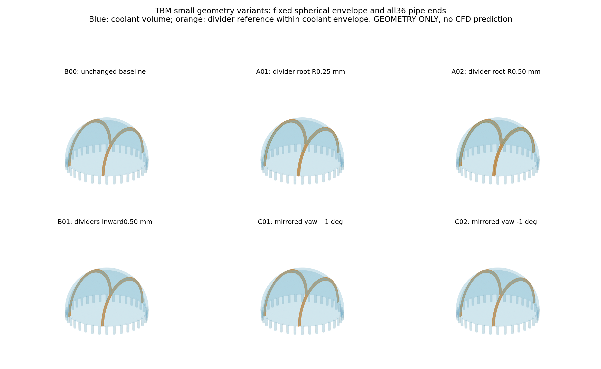
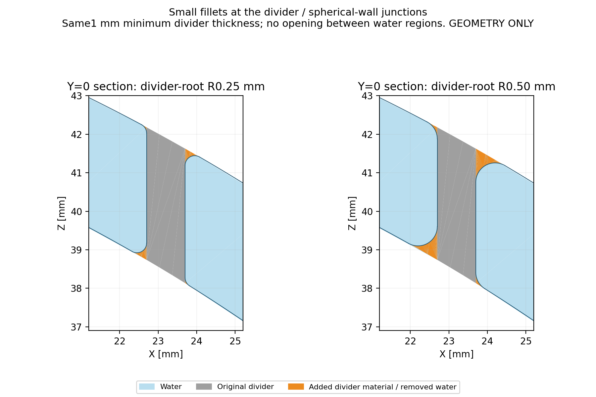
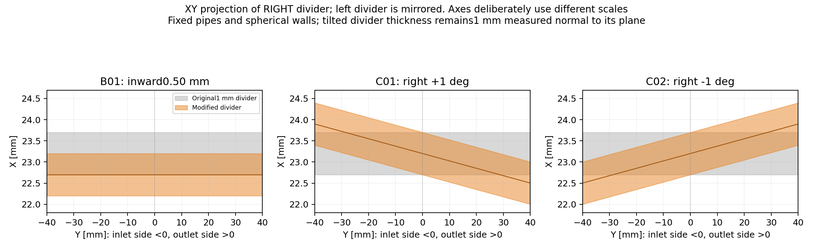
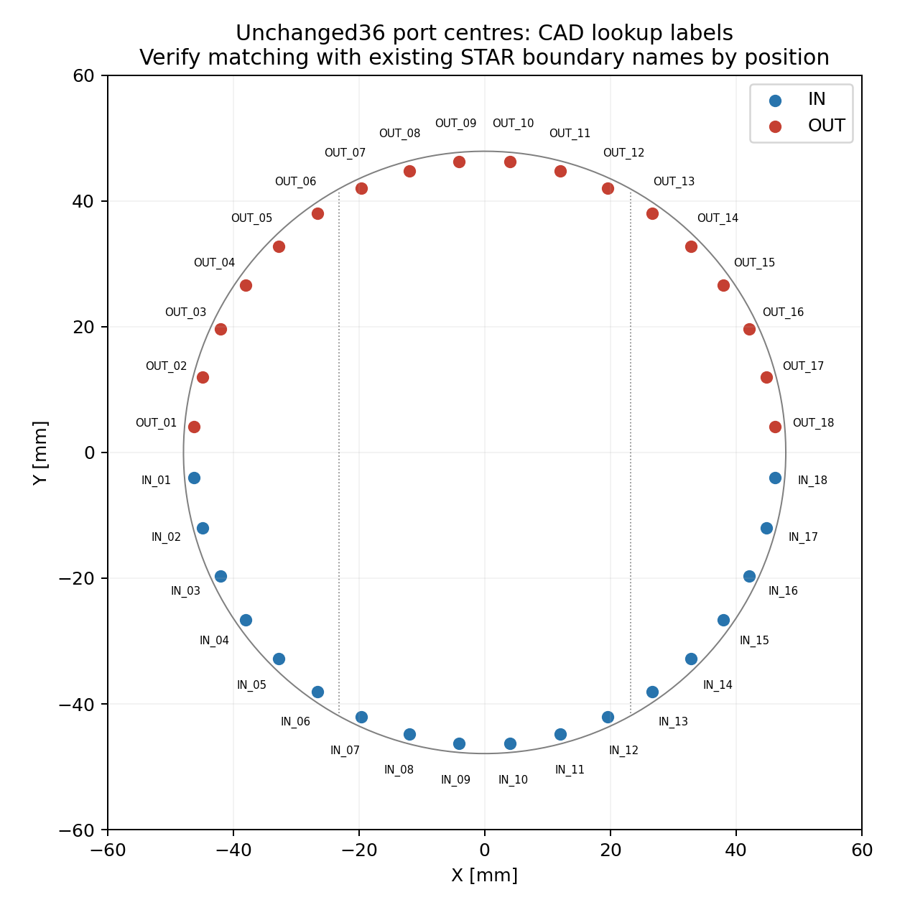

# TBMサブモジュール：基本構造を維持した小変更CAD案

**最初に比較する候補はA1（隔壁付け根R0.25 mm）です。** 変更範囲が最も小さく、元の管配置や3領域の分離を保ちながら、角部の形状に対する感度を調べられます。改善を確認した最適形状ではなく、CFDで比較するための案です。

元模型：`Blanlet_SimpleWater_20261023_v01.step`。入力は金属全体ではなく冷却水が占める領域のCADです。元の9ソリッドを接合すると3つの独立した水領域になります。基準模型B00はこの接合済み形状で、元形状とのBoolean対称差体積は0 mm³でした。

## STEPを使う

CFDへ読み込むのは **water/ 内の *_water.step** です。1案ずつ取り込み、既存の境界条件を確認して再設定してください。

**partition-reference/** は、冷却水路の範囲内に相当する隔壁部分だけの参考STEPです。変更する金属側形状の把握に使います。TBMの金属全体や製作図ではなく、冷却水として読み込むファイルではありません。

| 案 | 変更内容 | 変更した水領域の体積割合* | 水領域STEP |
|---|---|---:|---|
| 基準 | 元模型を接合し、3水領域として保存 | 0.000% | [B00_baseline_water.step](water/B00_baseline_water.step) |
| A1・最初の候補 | 隔壁と球面壁の付け根にR0.25 mm | 0.055% | [A01_root_R025_water.step](water/A01_root_R025_water.step) |
| A2 | 同じ場所のRを0.50 mmへ | 0.221% | [A02_root_R050_water.step](water/A02_root_R050_water.step) |
| B1 | 隔壁2枚を中央へ各0.50 mm移動 | 2.069% | [B01_partition_inward_050_water.step](water/B01_partition_inward_050_water.step) |
| C1 | 右隔壁+1°、左隔壁-1°をZ軸回りに回転 | 1.848% | [C01_partition_yaw_plus1_water.step](water/C01_partition_yaw_plus1_water.step) |
| C2 | 右隔壁-1°、左隔壁+1°をZ軸回りに回転 | 1.848% | [C02_partition_yaw_minus1_water.step](water/C02_partition_yaw_minus1_water.step) |

*「追加された水領域＋除かれた水領域」の体積を基準水領域体積で割った値です。低速域の減少率ではありません。B/C案は水領域の総体積がほぼ同じでも、隔壁位置の移動により一部の領域が入れ替わります。微小な体積差にはCAD数値積分差が含まれます。

## 各案で調べたい仮説

- A1/A2：隔壁と球面壁の角を滑らかにつなぎ、角付近の流れの剥離や滞留に変化が出るか調べる。最小変更の比較として優先する。ただし根元のRだけでは、隔壁に沿う主流そのものの方向は大きく変わらず、広い低速域が残る可能性もある。
- B1：中央と左右の流路幅を少し変え、領域内の流動抵抗と分配の感度を調べる。左右を広げると平均速度が下がる可能性もあるため、低速域対策としての効果はあらかじめ仮定しない。
- C1/C2：入口から出口へ向かう流れに対する隔壁の向きを変え、低速域の位置と出口流量の偏りがどう変わるか調べる。両方向を用意し、どちらが有利かをCFDで判断する。

## 維持した寸法・構成

- 水領域の球面内半径44.9 mm、外半径47.9 mm、基本の径方向水路厚3 mm。
- 全体の包絡寸法と向き。管は36本（入口18、出口18）、位置・内径3 mm・直管長10 mmを維持。
- 2枚の隔壁相当部と、3水領域の分離。水領域間の最小間隔1 mmを維持。
- 各水領域に入口6本・出口6本が属する対応を維持。3領域をつなぐ開口は追加していない。

A案の局所R部分だけは流路断面を変えます。水領域をわずかに削り、その分、金属側にすみ肉状の形を追加します。既存の隔壁相当幅を薄くする変更ではありません。ここで丸めているのは**隔壁と球面壁の付け根**で、管と球面水路の接続部の丸めではありません。

B案は中央の水路を合計1 mm狭め、左右をそれぞれ0.5 mm広げます。中央と側部の抵抗・速さに対して逆の影響が出る可能性があるため、全体で評価します。

C案は隔壁の中央位置を固定し、左右対称にZ軸回りで±1°だけ傾けます。隔壁の厚さは面の法線方向に1 mm。Y=40 mmでの中心線の移動は約0.70 mmです。C1/C2の効果の向きは流れ方向の解析で判断します。

## 確認したこと

全6案（基準1＋改良5）について、CADの健全性、3水領域と2隔壁参考部のソリッド数、STEP書き出し後の再読込、元の36開口の位置・面積、内径3 mm・長さ10 mmの円筒面36面、球面の内外径、3水域の分離を確認しました。STEP再読込前後のBoolean対称差体積は全案0 mm³でした。

最小水域間隔は全案1 mm。管内孔と隔壁参考部の最短離隔は、最も小さいC案でも約0.750 mmあり、管内孔と隔壁は干渉しません。これはCAD上の幾何検査です。製作方法・公差・接合・強度・熱応力は、金属全体のCADと照合して判断する必要があります。

詳細は[geometry-validation.json](geometry-validation.json)、一覧は[model-comparison.csv](model-comparison.csv)。STEPのハッシュ値はSHA256SUMS.txtにあります。

## 境界の割り当て

STEPの面番号は形状変更で変わり得ます。古い面番号の選択をそのまま引き継がず、[ports.csv](ports.csv)の位置で確認します。この資料ではY<0をIN、Y>0をOUTとし、それぞれX座標の小さい順に01〜18としています。STARの既存OUT番号とは座標で対応づけてください。

## 比較解析の進め方

まずB00とA1の2ケースを、同じ物性・流量・出口圧力・離散化・壁面処理で比較します。差が小さければA2でR寸法の感度を調べ、B1/C1/C2へ広げます。現在の未収束の1枚だけを基に、低速域が確実に減るとは判断しません。

元の条件を使う場合は290℃・実圧15.5 MPaの物性、合計0.23 kg/sを入口18本へ等分、出口ゲージ圧0を維持。STL等へ変換してメッシュを作る際、CADのmmからCFDのmへの変換は一度だけ行います。

詳しい評価項目は[CFD-comparison-plan.md](CFD-comparison-plan.md)。このCADセットでは新たなCFD計算を実施しておらず、低速域改善や収束改善を保証していません。

## 再生成

Python3.12 / CadQuery2.7.0で生成。元STEPは同梱していません。`generate_models.py --source <元STEP> --output <新しい出力フォルダ>`で同じパラメータの案を生成できます。既存フォルダへの上書きは拒否します。単位はmmです。
