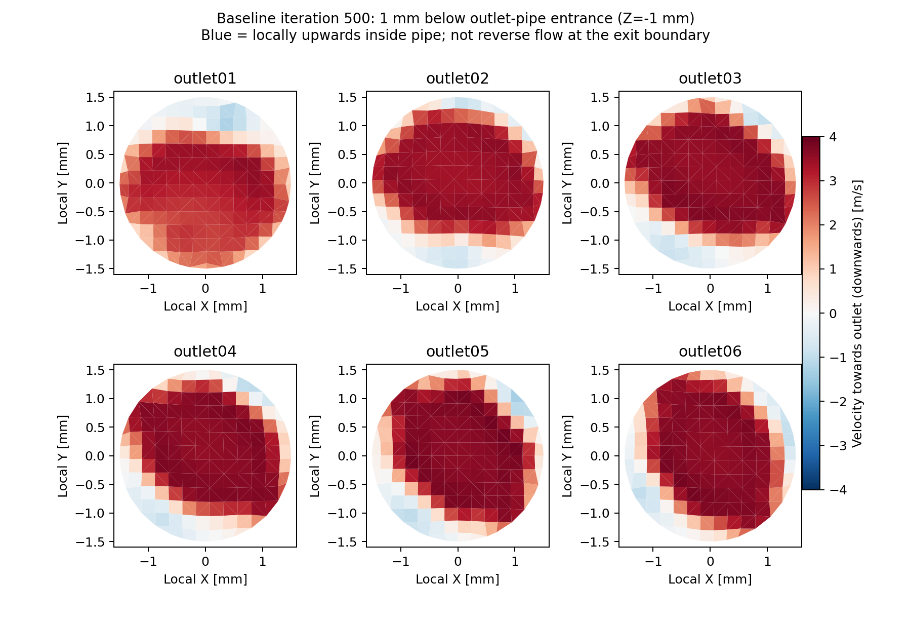
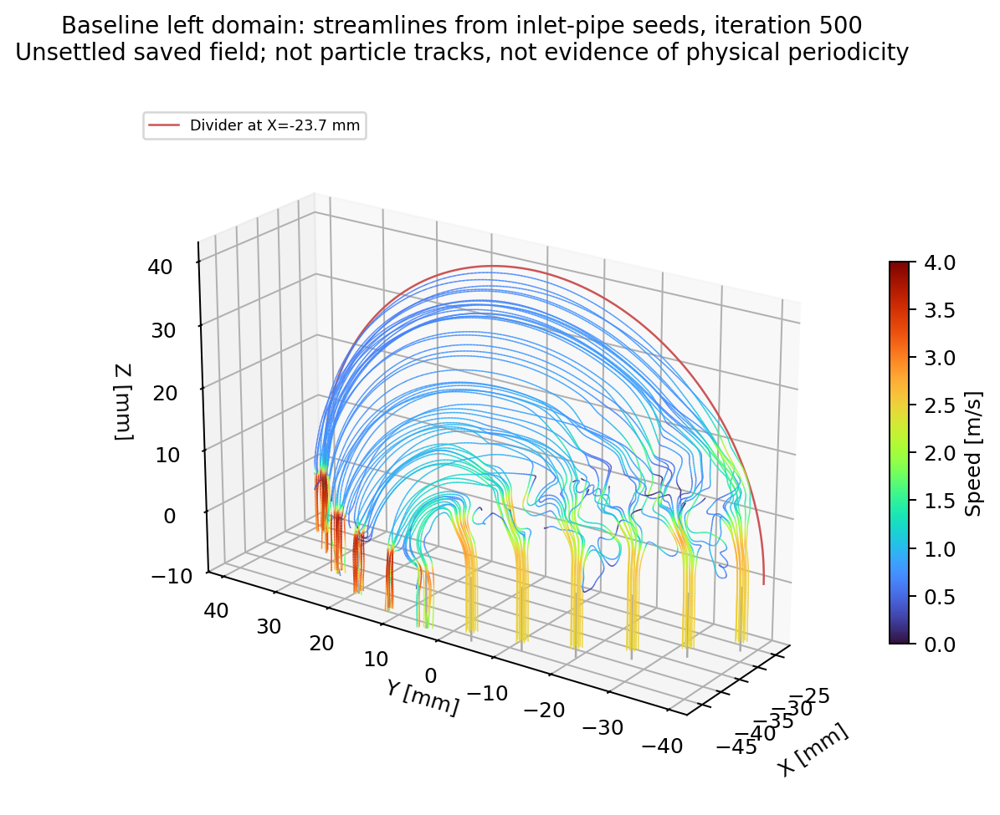
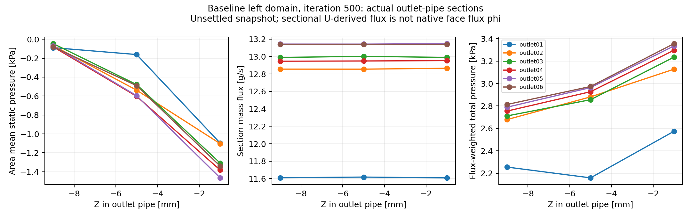
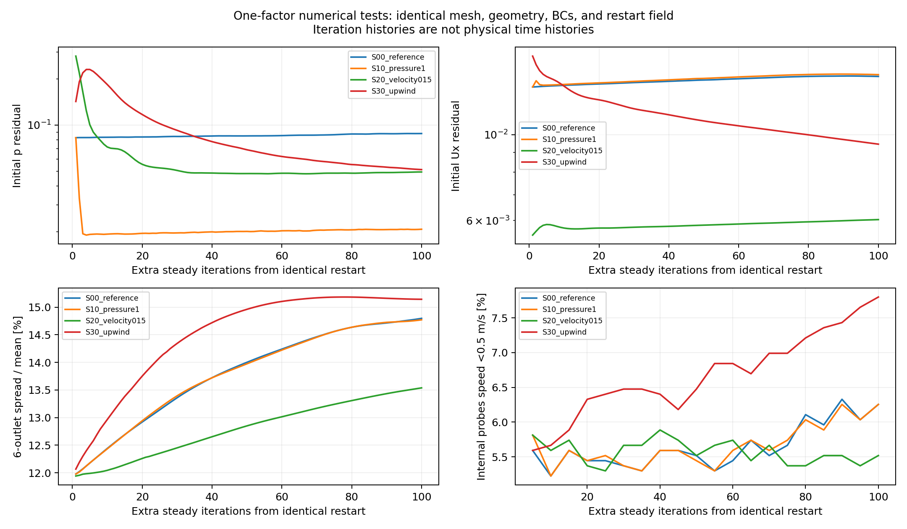
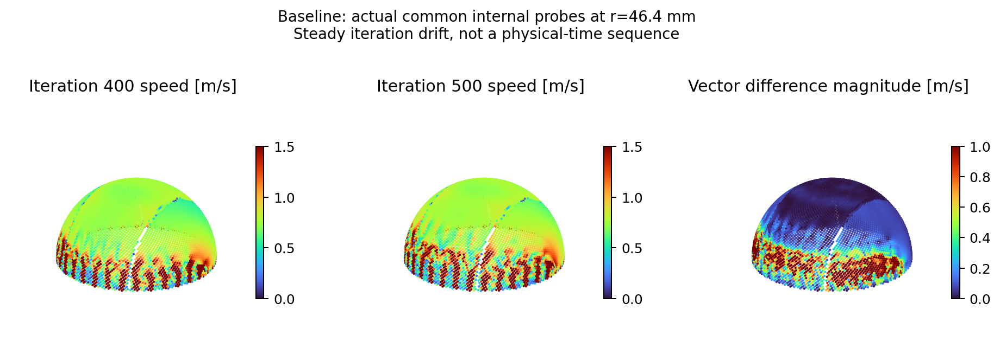
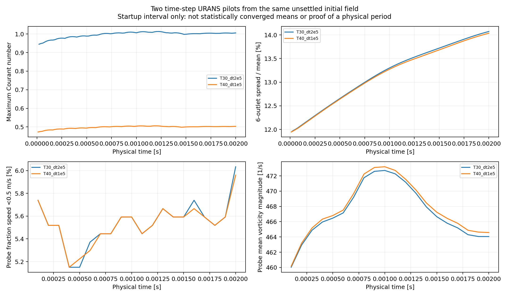
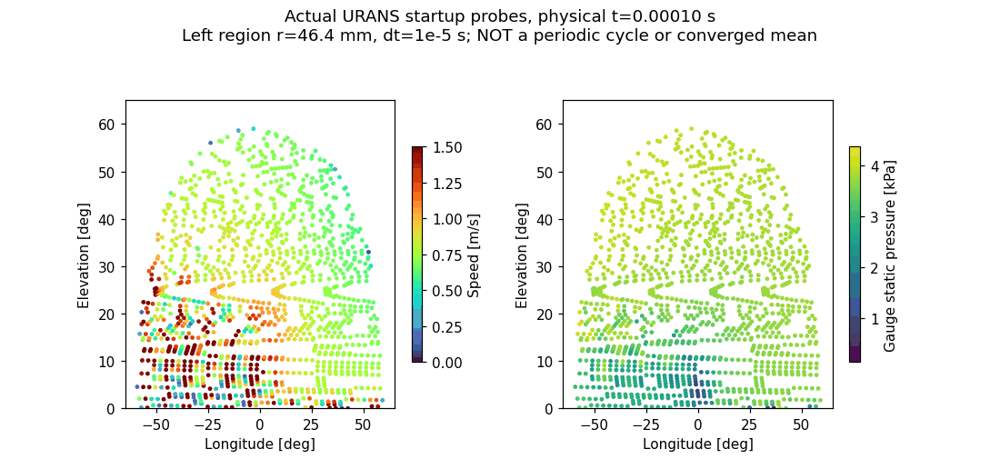

# TBMの未収束・出口流量偏り：基準模型での原因切り分け（2026-11-21）

**原因を一つに特定した段階ではありません。** 計算条件を一つずつ変える4ケースと、物理時間を進める2ケースの短い予備試験を実施しました。現状はA01の形状効果を評価する前に、計算の信頼性を整える必要があります。

確認できた主な点は次の通りです。

- 出口境界の逆流が0でも、出口管の入口寄りの内部断面には逆向き速度がある部分がありました。未収束の基準保存解では、逆向き流量は各管の正味流量の約2.1〜2.8%です。
- 元設定のまま100反復追加すると、左側6出口の流量偏りは約11.9%→14.8%へ変化しました。今の偏りを収束した形状固有値とは扱えません。
- 圧力の緩和変更では表示上の圧力残差は下がりましたが、内部速度場の変化はほぼ同じでした。100反復の範囲では、4ケースとも定常残差目標を満たしていません。
- 物理時間を使うURANSでも、短い初期区間を試験しました。周期性、統計的な平均、形状による低速域改善を確定する結果ではありません。

## 比較の対象と、今回変更していないもの

元のB00水領域の3領域は互いに接続していません。流量偏りを調べるため、左側のWater_Xminusを元の体積メッシュから抽出しました。**1,264,925セル、元と同じセル形状・流路形状・6入口・6出口**です。新しく切断して生じた内部境界面は0でした。したがって、領域を抽出するために新しい壁や新しい出口を作った試験ではありません。

290℃、物性基準の実圧15.5 MPa、密度746.200955901462 kg/m³、動粘度1.239443712658549e-7 m²/s、等温非圧縮RANS k–ω SST、重力なし。左側6入口に各0.23/18 kg/s、合計0.0766667 kg/sを与え、6出口はゲージ静圧0 Pa、滑らかな壁です。全18入口の条件は前回と同じです。初期場は前回の基準B00の500反復の未収束場を全ケースで共通に使いました。

A01や別の形状を新たに変更した計算ではありません。[前回のA01比較](https://github.com/miumiu031024-ship-it/TBM/blob/main/a01-cfd-comparison-20261120/README.md)とは目的を分け、基準の未収束を先に調べています。A01は隔壁と内外球面の付け根のR0.25 mmで、改善はまだ確認できていません。

物性の照合も必要です。温度の入力が同じでも、一定物性モデルでは密度・粘度の値が自動的に同じになるとは限りません。今回の物性では、各入口の解析的な平均速度は約2.42 m/s、管径3 mmによるReは約5.86×10⁴です。密度は同じ質量流量に対する速度、粘度はReと流動抵抗に影響します。STAR側の実際のρ・μは確認待ちであり、物性の違いが原因だと断定していません。

**ユーザーのSTAR-CCM+の10,000反復の履歴や`.sim`を直接解析したものではありません。** 今回はOpenFOAM v2412の保存場と追加計算による切り分けです。STARのグラフの左右約33〜34%という偏りや、残差の周期を定量再現したとは言えません。ユーザーから、STARの図も添付v01と同じ形状・合計0.23 kg/s・18入口等分の条件と確認いただきました。さらにSTAR側もSST k–ω、プリズム層数は不明と確認いただきました。形状・流入条件・乱流モデル名の違いを理由にはせず、まだ未確認のメッシュとプリズム層・y+・壁面処理、モデルの細部、離散化、線形・非線形解法、未収束の到達状態の差を調べる必要があります。

## 出口に逆流がなくても、内部には逆向きの流れがあり得る

出口面Z=-10 mmと、管の入口寄りZ=-1 mmは異なる場所です。前回の500反復の保存されたソルバー面流束phiでは、左側6出口の出口面逆流は0 kg/sでした。一方、同じ保存場のZ=-1 mmの内部断面で速度を調べると、管の周辺部に上向き（出口とは逆方向）の速度がありました。

赤が出口方向の下向き速度、青が逆向きの上向き速度です。速さの大きさだけでは、この符号の違いは分かりません。内部断面の逆向き流量は、三角形断面の速度からρU·nを積分した診断値で、出口境界のnative phiとは別の量です。これは未収束の場における局所的な逆向き流れの証拠であり、物理的な周期渦、閉じた再循環、未収束の原因の確定を意味しません。

[基準の各管断面値](baseline-pipe-sections.csv)、各Sケースの`*-pipe-sections.csv`、[出口面のphiと境界速度の比較](exit-flux-consistency.csv)を併記しています。管入口寄りの逆向き速度は、圧力緩和だけ変更したケースなどでも残っていました。ただし、どの定常ケースもまだ未収束です。

これは基準500反復の一つの速度場に対する72本の流線です。粒子の時間軌跡や、渦が周期的に生まれる様子を撮影したものではありません。未収束の場を使った経路の参考図として扱ってください。

## なぜ同じ領域の出口流量が違うのか

出口の静圧がすべて0 Paでも、各出口に接近するまでの圧力・運動量・方向転換・入口損失が等しいとは限りません。静圧だけでなく速度分布と全圧も含めて、圧力仕事、対流による運動量輸送、粘性・乱流輸送の釣合いを見る必要があります。

今回の管はすべて内径3 mm、長さ10 mmですが、基準500反復ではOUT_01の流量が約11.6 g/s、OUT_06が約13.1 g/sと異なっています。入口に近い内部断面Z=-1 mmの流束重み付き全圧も、およそ2.57 kPa対3.36 kPaと違っていました。これは流れの到達状態が同一ではないという参考所見であり、慣性だけで偏りを説明したり、損失係数を確定したりする値ではありません。

横軸は管の位置で、右側Z=-1 mmが球面水路に近く、左側Z=-9 mmが出口面に近い位置です。管入口付近では加速・偏った速度分布・逆向き速度があるため、静圧が一時的に負になり、下流で回復することがあります。図の負の値はゲージ圧で、実圧15.5 MPaを基準とした数kPaの変化です。この未収束の断面値から総圧損失の確定値や熱性能は求めていません。

出口面から1 mm上流（Z=-9 mm）では、横方向速度の断面内・面積加重RMSが軸方向平均速度の約5〜9%でした。これは平均流の空間的な横流れの指標で、乱流強度の時間RMSではありません。内径3 mmに対して管長10 mm（約3.3D）なので、出口付近に完全な軸方向流れを仮定する根拠はまだありません。[追加の断面診断値](SeedSide-pipe-sections.csv)に記録しています。出口逆流が0でも、出口境界を置く位置や下流配管のモデル化への感度を調べる余地があります。ただし、単に管を延長して同じ出口圧を与えると流路抵抗自体も変わるため、その結果の均一化を元模型の形状改善と解釈してはいけません。

中央と左右の形状・流れの経路は異なるので、中央の出口流量がほぼ均一でも左右が同じになるとは限りません。また、出口流量は面積積分であり、均一な出口流量と内部の局所低速域は両立します。

## 数値条件を一つずつ変えた結果

同じ初期場から100反復ずつ追加し、500→600反復を比較しました。通常設定はSIMPLEC、圧力緩和0.2、速度緩和0.3、速度の対流項は二次精度linearUpwindです。各ケースで変更した数値条件は下表の一項目だけです。監視点や監視頻度、乱流モデル、物性、境界条件、メッシュは共通です。

| 追加計算の条件 | 最終p初期残差 | 最終Ux初期残差 | 550→600反復の内部速度L2変化 | 6出口の流量偏り |
|---|---:|---:|---:|---:|
| 元設定のまま | 0.08803 | 0.01414 | 39.07% | 14.80% |
| 圧力緩和だけ0.2→1.0 | 0.02082 | 0.01429 | 39.11% | 14.77% |
| 速度緩和だけ0.3→0.15 | 0.04933 | 0.006035 | 23.63% | 13.54% |
| 速度の対流項だけ一次精度へ | 0.05114 | 0.009454 | 31.16% | 15.14% |

内部速度のL2変化は、同じセルのベクトル差の相対ノルムで非体積加重です。真の誤差、時間変動率、全点の速さの一律変化ではありません。流量偏りは（最大−最小）÷6出口の平均です。残差の正規化は係数行列や緩和の影響を受けるため、残差の数字だけで優劣を決めず、内部速度と流量履歴を併記しています。

圧力緩和1.0ではp残差が約4分の1になりましたが、内部速度の変化は約39%で元設定とほぼ同じです。圧力残差を下げることと、流れの解が落ち着くことは別です。この圧力1.0は今回のOpenFOAM/SIMPLECでの試験条件です。

速度緩和0.15では内部速度の変化が減りましたが、更新幅を小さくした結果も含みます。遅く更新していることを、収束や精度の証明にはできません。一次精度では残差の下降が見られましたが、100反復で目標は満たしていません。また数値拡散が増えるため、仮に収束してもそのまま形状性能の最終評価に採用できません。

**この試験から分かったのは、単に圧力緩和を変えるだけでは解決せず、速度・離散化への感度と未収束による流量分配の変化があるということです。** 100反復だけで定常解が存在しないことや、物理的な周期現象を証明したわけではありません。

## メッシュの位置も確認した

左領域の凹形状セルは14,561個（全1,264,925セルの1.15%）でした。そのうち11,712個（約80.4%）が、隔壁から0.6 mm以内の領域にありました。直管内では凹形状セルは0でした。

[場所別の検査値](mesh-quality-location.json)を保存しています。領域定義は一部重なります。負の体積やトポロジー破綻を確認したという意味ではなく、凹形状セルがあることだけで計算不安定の原因を断定できません。根元の局所メッシュ・壁面近傍の格子への感度を優先して調べる理由にはなります。現在は明示的なプリズム境界層がなく、壁関数を使っています。境界層格子・y+・剥離を扱う壁面処理の組合せは、まだ格子独立性の検証を終えていません。

## 内部のどこが変化しているか

前回のB00に保存された同一8,013点の400反復と500反復を直接比較しました。速度ベクトル差が0.2 m/sを超える点は全体の約23%でした。Z<5 mmの下部水路では約38%、Z>20 mmの上部では約4.6%です。流れの変化は隔壁だけに限定されておらず、下部水路を含む広い範囲にあります。隔壁付近のメッシュ検査結果との位置の重なりだけで、そこが唯一の原因だとは言えません。

この図も物理時間の連続画像ではなく、定常反復中の場の変化です。[場所別集計](iteration-change-location.json)と元の2時点の[内部サンプル](iteration-change-samples.npz)を同梱しています。前回の100,000点の最終面積比較とは別の監視点群です。

## 周期的な残差と、内部の流れの関係

定常計算の反復は物理時間ではありません。速度→圧力補正→流束→乱流粘性→次の速度という反復が、数値設定や格子によって周期を持つ場合があります。一方、実際に剥離せん断層や大きな循環が揺れているなら、流速・圧力・分配流量が物理時間で変動し、定常解へ落ち着きにくい場合もあります。**残差の周期だけでは両者を区別できず、反復周期をHzに換算することもできません。**

以前の回答では、STARの約2,000〜2,700反復付近に「設定変更または初期化をした」と確認されています。変更内容がまだ不明なので、その付近の残差の急上昇を自然な渦の発生と解釈することはできません。変更前後の区間を分けて調べ、その後の繰り返しも別に確認する必要があります。

内部の低速域の移動や局所的な渦が候補になりますが、今回の保存流線や逆向き速度から「周期渦が原因」とは言えません。渦度の大きさも、壁面せん断で大きくなるため、それだけで渦の存在や原因を決められません。URANS/SSTで調べるのはモデル化された乱流平均流の非定常構造であり、DNSのように全ての乱流渦を直接解いているわけではありません。

関係を調べるには、同じ物理時刻で次の量を同時に記録します。

1. 隔壁付近と管入口付近の速度・圧力・渦度、低速域の位置と面積割合。
2. OUT_01〜06の各流量と、例えばOUT_06−OUT_01の流量差。
3. 時間ステップ内の反復収束、クーラン数、質量収支。

十分長い安定した区間で、圧力・内部速度・出口流量に同じ周波数があるか、位相差はどうか、時間刻みを半分にしても周期が一致するかを見ます。単に初期過渡中の上昇・下降が似ていることから相関や因果を決めません。ユーザーのSTARの周期を直接調べるには、残差と各流量・局所量の同期した履歴と、設定変更の記録が必要です。

## 物理時間を進めた予備試験

初めのΔt=1e-4 sの試験で、最大クーラン数が約5になりました。その試験は打ち切って前処理試験として保存し、最終比較から除外しました。以下は時間刻みを小さくしてやり直した独立の2ケースです。backward時間離散化、PIMPLE外側2回、圧力補正1回・非直交補正1回を共通にし、同じ初期場から開始しました。

| ケース | 時間刻み s | 計算した物理時刻 s | ステップ数 | 最大Co | 状態 |
|---|---:|---:|---:|---:|---|
| T30_dt2e5 | 2.0e-05 | 0.002 | 100 | 1.014 | 正常終了 |
| T40_dt1e5 | 1.0e-05 | 0.002 | 200 | 0.506 | 正常終了 |

今回の短い試験は、非定常計算が動作し、時間刻みによる違いを確認するための初期検証です。左領域の体積と流量から求める平均滞留時間の目安は約0.105 sで、この試験時間より長い値です。小さな局所変動の時間尺度はそれより短い場合もありますが、短い初期過渡から全領域の周期・統計平均・冷却改善は確定しません。

最終時刻0.002 sの2ケース間の体積セル速度ベクトル相対L2差は **1.352%** でした（細かい時間刻み側を分母）。 共通の内部監視点では相対L2差0.525%、最大ベクトル差0.1607 m/s、0.5 m/s未満の割合の差+0.074パーセントポイントでした。

内部監視点の割合の差約0.074パーセントポイントは、この1,359点では1点分です。これだけで小さな低速面積差の精度を主張できません。全セルの差も残っており、時間刻み独立性は未確立です。

詳細は[transient-pilots-summary.json](transient-pilots-summary.json)に記録しています。この差が小さくても、長時間・格子・乱流モデルの検証を置き換えるものではありません。また、外側反復回数を増やす時間ステップ内の非線形収束感度は未完了です。各線形方程式の残差だけで物理時間の精度を確定していません。`physical-*-history.csv`では時刻の単位を秒とし、Sケースの反復番号と混在させていません。

この動画は細かい時間刻みのケースで保存した1,359個の内部監視点の速度と静圧です。球面を経度・仰角へ展開し、実際の物理時刻を表示しています。初期過渡の20フレームであり、周期の一周を示す動画ではありません。[最終監視点の図](physical-final-probes.png)、[ParaView用の最終点群](T40_dt1e5-final-probes.vtp)、各ケースの`*-physical-probes.npz`もあります。体積セルの全場を示した点群ではありません。

この4 CPU環境で、細かい時間刻みの2 ms試験の実測計算時間は約17.6分でした。単純比例なら0.1 sでも約14.6時間となりますが、実際の時間は反復数や計算条件で変わります。本番の長期統計を取る前に時間刻み・内部反復・格子の感度を確認し、計算資源を計画する必要があります。

## 次に進める順序

まず基準B00で、隔壁付近の品質と境界層メッシュへの感度、一次精度で長く立ち上げた後に二次精度へ戻す方法への感度を確認します。定常解が安定しない場合は、時間刻みと時間ステップ内反復の感度を確認したURANSを延長し、初期過渡を除いて複数の滞留時間と複数周期を観測します。低速域割合・各出口の平均流量・圧力が区間を分けても安定することを確認してからB00とA01を同じ方法で比較します。

A01を「効かない形状」と確定したり、未収束のままA02や角度変更の優劣を決めたりはしません。単に反復数を10,000へ増やすことも、原因の切り分けや物理時間の観測の代わりにはなりません。

## 同梱データと再現性

図・CSV・集計JSON、全試験の解法と境界条件、計算ログ、速度・圧力・渦度の元の監視履歴、実行スクリプト、ハッシュを同梱します。巨大な体積メッシュや全体積場は含みません。入力メッシュは前回のB00から抽出したもので、前回のCADセット・生成スクリプトとOpenFOAM v2412の同じ環境が必要です。作業スクリプトは実際の絶対パスを含むので、再実行時は保存先を合わせてください。

対象領域は左側のみです。中央・右側の収束や流量偏りを今回の追加試験で確認したとは言えません。今回も等温の流動解析であり、金属・熱流束・壁温・熱伝達・核融合炉としての製作性や健全性を評価していません。
