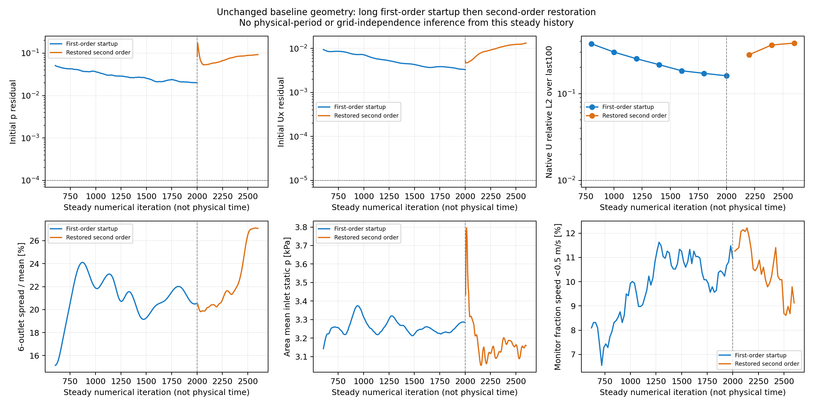
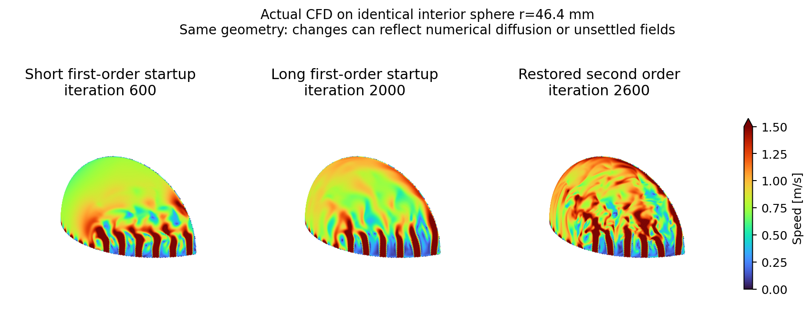
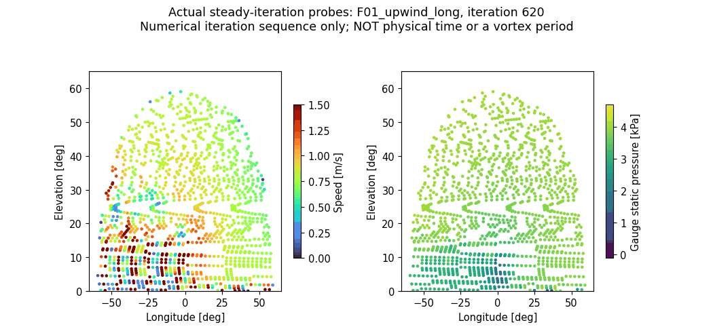
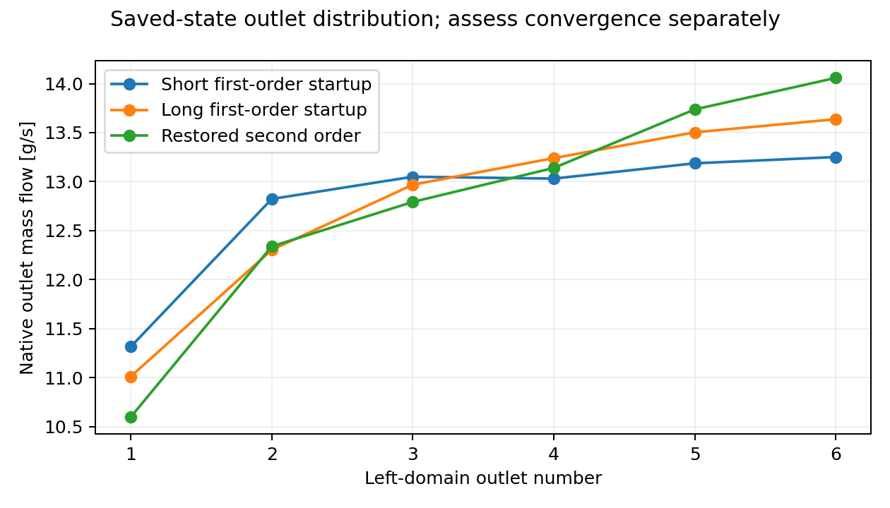

# 一次精度で長く立ち上げ、二次精度へ戻す試験（2026-11-21）

**長い一次精度の立上げと二次精度への復帰を実行しましたが、今回の反復上限までに、事前に決めた数値収束基準は満たせませんでした。** この方法だけでは今回の未収束は解消していません。定常解が存在しないことや、周期渦が原因であることを証明した結果ではありません。

今回行ったのは、前回の結果で残差が下降した一次精度を、100反復で止めずに長く続け、保存解を初期値として二次精度へ戻す方法です。模型の変更ではなく、基準模型の数値計算方法の検証です。

## 実行した範囲

基準B00の左側Water_Xminus、同じ1,264,925セル、同じ6入口・6出口を使いました。合計0.23 kg/sを18入口へ等分した条件の左側分0.0766667 kg/s、出口ゲージ圧0 Pa、水290℃・実圧15.5 MPa相当の一定物性、SST k–ωを維持しています。形状・メッシュ・管・隔壁の変更はありません。旧データとCADは読み取り専用で扱いました。

前回の一次精度ケースの600反復の保存解から開始しました。今回の一次精度継続は **1400反復（600→2000）**、二次精度への復帰後は **600反復（2000→2600）**です。OpenFOAMのログではTimeと表示されますが、steadyStateの計算なので物理時刻ではなく反復ラベルです。反復ラベルの全期間が一次精度という意味ではありません。前回の500→600反復は一次精度、その前には二次精度の履歴があります。

圧力緩和0.2、速度/乱流量緩和0.3、SIMPLEC、非直交補正0、制限付き勾配を維持し、復帰時に変更したのは速度の対流項upwind→linearUpwindだけです。乱流量k・ωの対流項は両段階でupwindのままです。復帰の初期値は、一次精度の終了時点のU/p/phi/k/omega/nutをそのまま複製し、6ファイルの一致を独立に確認しました。

**一次精度も全基準に届かないまま上限に達し、未収束の保存解から二次精度へ戻す診断を行いました。十分に収束した一次精度解からの復帰試験を完了したという意味ではありません。この結果だけで、立上げ不足という可能性を完全に除外することはできません。**

一次精度の継続中、直前100反復間の速度ベクトル相対L2変化は、最初の評価点800反復で37.50%、終了時に16.04%となり、小さくなりました。これは数値反復中の更新量の比較で、真の解への誤差を測ったものではありません。

## 判定基準と実測値

[実行手順の計画](PLAN_JA.md)と[機械可読の判定基準](plan.json)を同梱しました。判定基準は最初の200反復の評価前に設定し、その後は変更していません。最後100反復で残差目標p<1e-4、U/k/ω<1e-5を満たすことに加え、速度・低速域・出口流量の安定も全て必要としました。 ソルバーは200反復ずつ実行し、Python側で7項目を外部判定しています。残差だけによる内蔵の自動停止は使っていません。ログの正常終了は、その区間の計算が処理として終了したことを示し、収束したことを意味しません。

| 状態 | 反復ラベル | 最終p初期残差 | 最終Ux初期残差 | 直前100反復間の速度L2変化 | 低速点集合のIoU | 6出口の流量偏り | 達成項目数 |
|---|---:|---:|---:|---:|---:|---:|---:|
| 長い一次精度の立上げ後 | 2000 | 0.0199 | 0.003312 | 16.04% | 0.676 | 20.54% | 1/7 |
| 二次精度への復帰後 | 2600 | 0.09251 | 0.01323 | 38.24% | 0.432 | 27.07% | 1/7 |

表の残差は最終反復の値です。合否は最終値だけでなく最後100反復の全区間で判定しました。L2変化は同じ体積セルの速度ベクトル差をまとめた非体積加重の相対ノルムで、真の誤差でも、全点の速さが一律その割合で変わったという意味でもありません。IoUは100反復前後の低速点集合の共通部分÷和集合で、1に近いほど位置が同じです。

| 確認した項目 | 一次精度の終了時 | 二次精度の終了時 |
|---|---|---|
| 最後100反復の残差 | 未達 | 未達 |
| 保存した体積セルの速度変化 | 未達 | 未達 |
| 内部監視点の速度変化 | 未達 | 未達 |
| 低速域割合の安定 | 未達 | 未達 |
| 低速域位置の安定 | 未達 | 未達 |
| 6出口それぞれの流量の安定 | 未達 | 未達 |
| 入口・出口の全体質量収支 | 達成 | 達成 |

流量偏りは（6出口の最大流量−最小流量）÷平均流量です。流量偏りが小さいことを収束基準にはしていません。各流量が大きく変化し続けていないかを判定しています。均等な分配と、安定した解は別の指標です。

復帰直後（2001反復）のp初期残差は0.08393、一次精度の終了時（2000反復）は0.0199でした。 約4.22倍の変化です。同じ保存場を引き継いでも、離散化の変更で残差は大きく変わり得ます。この切替直後の跳ねだけを、物理的な渦の発生や流れの周期の証拠として扱いません。

灰色の縦線が二次精度へ戻した位置です。全て定常計算の数値反復であり、横軸を物理時間・渦の周波数として扱いません。`F01_upwind_long`と`F02_second_order_restore`の各CSV・assessment JSONに、200反復ごとの値と未達項目を保存しています。

[場所別の更新量](spatial-update-location.csv)も記録しました。表は最後100反復間の速度ベクトル差の大きさを、同じ内部監視点で平均した値です。速度が時間的に変化する速さや加速度ではなく、二つの定常反復の保存場の差です。

| 内部の位置 | 一次精度終了時の平均ベクトル差 m/s | 二次精度終了時の平均ベクトル差 m/s |
|---|---:|---:|
| 下部 Z<5 mm | 0.0659 | 0.1796 |
| 中間 5≤Z<20 mm | 0.2091 | 0.4981 |
| 上部 Z≥20 mm | 0.1083 | 0.3530 |

更新が大きい場所の確認であり、そこが唯一の不安定化原因だという証明ではありません。

## 同じ形状でも、数値設定や未収束で低速域は変わる

左が前回の短い一次精度立上げ後（600反復）、中央が今回の長い一次精度立上げ後、右が二次精度への復帰後です。同じ内部球面r=46.4 mm、同じ共通の水領域のサンプル点、同じ色範囲を使っています。1.5 m/sを超える速度は同じ赤色で飽和します。壁面の速度を示した図ではありません。

| 保存場 | 反復ラベル | 速さ0.5 m/s未満の面積 mm² | 共通水面積に対する割合 |
|---|---:|---:|---:|
| S30_upwind | 600 | 231.9 | 7.005% |
| F01_upwind_long | 2000 | 319.8 | 9.662% |
| F02_second_order_restore | 2600 | 302.5 | 9.139% |

元の半球面に等面積配置した100,000点から左側を選び、全保存場で水が存在する共通点だけを比較しました。r=45.2/47.6 mmと別の速度しきい値も[CSV](low-speed-same-geometry.csv)にあります。内部の1,359監視点とは異なるサンプリングです。

**ここには模型の形状変更がありません。低速面積が減った場合も、A01の改善や基準模型の冷却性能向上を表すものではありません。** 一次精度の数値拡散、二次精度への復帰、残っている未収束の影響が含まれます。形状比較の前に、同じ計算方法で評価する必要がある理由を示すデータです。

この動画は、実際に保存した内部1,359点の速度と静圧を反復順に表示しています。画面の数字は数値反復で、物理時間ではありません。物理的な渦の周期や粒子の移動速度を表す動画として扱いません。

## 出口流量と逆流

[各出口の保存場の値](outlet-snapshots.csv)では、面流束phiによる正味・順流・逆流を分けました。[保存した反復ごとの出口面逆流](outlet-backflow-snapshot-history.csv)で確認した最大逆流量は、1出口あたり0 kg/sでした。全反復で逆流が無かったことを証明するものではありません。

境界速度ρU·Sとソルバー面流束phiは別々に記録しています。圧力補正された面流束と境界速度の積分が同じであると仮定せず、収支にはnative phiを用いました。管内部の逆向き速度や周期渦の有無を、この出口面の値だけから判定しません。

## 分かったことの範囲

今回の試験は、この基準格子・乱流モデル・物性・境界条件での数値解の立上げ方法を調べたものです。数値収束基準を満たす場合も、格子独立性、実験との一致、金属の温度・熱伝達、製作性まで確認した結果ではありません。元のメッシュには隔壁付近の凹形状セルがあり、明示的なプリズム境界層がないため、格子と壁面処理への感度確認は別に必要です。

STAR側と同じ形状・流入条件・SST k–ωであることは確認済みですが、STARの1万反復の保存解を解析したものではありません。STAR側のメッシュ・壁面処理・密度/粘度・設定変更の詳細を照合する必要があります。今回の定常反復の揺れから、物理的な周期や周期渦を確定することはできません。

## 次の判断

今回は二次精度への復帰後も基準を満たしていないため、次に優先するのは、形状を変えずに隔壁付近の格子品質と壁面近傍の扱いを確認することです。最初に非直交補正などの数値設定を一項目だけ変更する対照試験を行い、その後、隔壁付近の格子と境界層を改善した格子で同じ指標を比べると、設定の影響と格子の影響を区別しやすくなります。これらは次の試験の提案であり、今回実行した内容には含みません。

物理的な周期変動を評価するには、時間刻みと各時間ステップ内の反復を検証した非定常計算を十分長く行います。基準模型の比較方法が安定してから、同じ方法でA01や次の構造案を比較します。

反復上限までに基準に届かなかったケースも、定常解が絶対に存在しないとは結論しません。各履歴の下降・停滞・振動を見て、次の試験を選びます。一次精度が安定し二次精度が不安定な場合も、一次精度の数値拡散が物理的な変動を弱めた可能性があるため、原因を数値誤差だけと断定しません。

## 同梱データ

実行計画、初回評価前に設定した判定基準、各チェックポイントの結果、図、CSV、実際の内部サンプルNPZ、解法・物性・境界条件の記述、計算ログ・元の監視履歴、作業スクリプトとハッシュを同梱しています。体積メッシュと巨大な全体積場はダウンロードZIPに含みません。元のメッシュ・保存場は作業環境に保持しています。スクリプトは実際の絶対パスを含むため、再実行時は元のデータとパスを用意してください。
