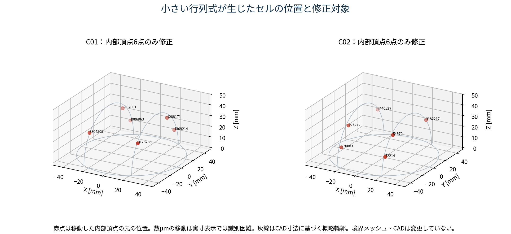
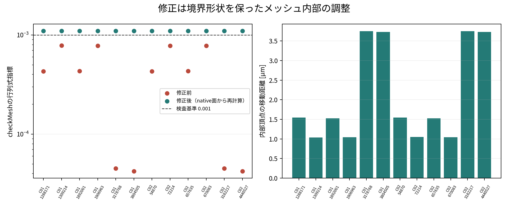
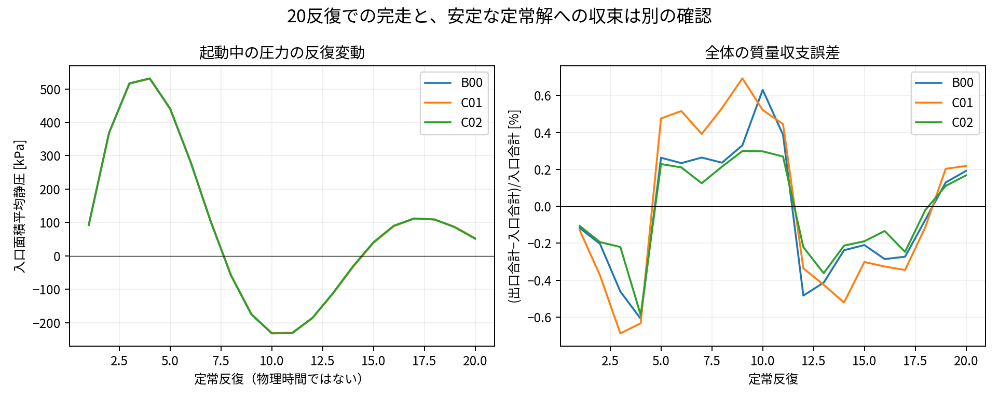
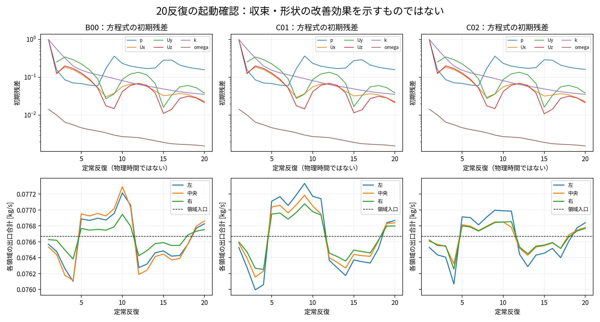

# メッシュ品質修正と20反復の起動確認（2026年11月25日）

C01・C02の小さい行列式のセルを、各6個から0個に修正した。変更したのは各モデル6点の**内部メッシュ頂点**だけで、CAD、球面・隔壁・36管の境界頂点、境界面、セル接続は変更していない。B00は元のメッシュと同一である。3モデルの20反復試運転はいずれも正常終了し、保存した各場の内部値が有限であることを確認した。**200反復は実行していない。**

通常検査は3モデルとも合格した。一方、詳細検査の凹形セルの指摘は残るため、「メッシュ品質の全項目に合格した」「低速域が改善した」「未収束の原因を解消した」とは結論しない。

## 問題セルの位置と指標

元のC01・C02では各6セルがcheckMeshの行列式基準0.001を下回っていた。最小値は両方とも約4.24×10⁻⁵。各セルは6面のうち内部面3面、壁面3面を持ち、隔壁と内外球面の接合付近に位置する。問題セルのID、位置、内部面を使う行列式、全ての面を使う指標、固有値は[元の問題セル一覧](original-bad-cell-indicators.csv)に保存した。同CSVのx/y/zはセル頂点の平均座標であり、流れ場や体積重心の測定値ではない。

今回の行列式はセルの体積やCAD変形の行列式ではなく、面の向きから作るテンソルの指標である。実際の圧力方程式の係数行列の行列式を計算した値でもない。OpenFOAM v2412のソースを確認し、nativeの面データから再計算して、検査ログの最小値を再現した。

- `checkMesh`の詳細検査：内部面／結合面を使い、面積を平均面積で正規化したテンソルの行列式を使う。今回のnativeメッシュの検査基準は0.001。
- `snappyHexMesh`の品質処理：境界面を含む全ての面を使い、別の正規化をする。

そのため、生成ログの品質エラー0と、後段の詳細検査の6セルは両立する。定義とソース位置は[定義記録](determinant-definition.json)を参照。問題セルで内部面の向きが十分独立していないことが直接の検出理由である。

隔壁を±1°回転したことと背景格子・球面へのスナップの組合せが、接合付近のセルを作りにくくしている可能性がある。ただし、今回の調査だけで単一の生成工程を原因と断定しない。元のセル体積は正であり、6セルの存在だけで以前の残差の周期振動を説明することもできない。

## 採用した修正と、採用しなかった試験

採用した方法をR07と呼ぶ。snappyHexMeshの設定だけを変えて全面再生成したメッシュではなく、生成済みメッシュに対する内部点の品質最適化という後処理である。これは**CFD用メッシュの修正番号であり、新しいCADモデル名ではない。**

1. 各問題セルについて、全ての物理境界面に属さない内部頂点1点を特定する。
2. 移動距離を最小化しつつ、その点に接続するセルの行列式を0.0011以上にする。
3. 接続するセルの面ピラミッド体積が正であること、影響する内部面の非直交角が65°以下であることも制約にする。
4. 変更した座標を別コピーへ適用し、OpenFOAM本体でメッシュ全体を通常・詳細の両方で検査する。

各点の移動距離は1.039〜3.749 µm（約0.001〜0.004 mm）。セル数とセルIDを維持する。境界に属する頂点は一切動かしておらず、面・owner・neighbour・boundary・cellZones等は元とSHA-256が一致した。36管の面積、接続する3領域、隔壁の角度・位置もそのまま維持される。境界を保存したため、元のCADに対するメッシュの近似誤差や壁近傍の解像度も引き継いでいる。[座標変更一覧](mesh-quality/internal-point-adjustments.csv)、[境界保存の証拠](mesh-quality/exact-boundary-preservation.json)を参照。

背景格子の位相を変える再生成試験R01も開始したが、境界を厳密に保存できる内部頂点修正を優先し、完了前に中止した。合格したメッシュとして扱っていない。単純な隣接セル結合R02と、境界面の角度を保護したR03も試したが、最大非直交角約90.5°、不正な面ピラミッド等が発生したため不採用。行列式だけが良くても、他の指標を悪化させる修正は採用していない。候補選択の別試行R04・R05も局所条件を満たさず不採用であり、これらのメッシュではCFDを実行していない。入力・ログ・選択情報は`rejected-trials/`に保存した。

## 修正前後の同一検査

B00は基準構造、C01は出口側で左右領域を広げた既存の±1°隔壁、C02はその逆方向の既存隔壁である。今回、それらのCADの位置・角度・寸法は変更していない。

全モデルに`checkMesh -allTopology`と`checkMesh -allTopology -allGeometry`を実施した。行列式の許容基準を緩めて合格させたものではない。

| モデル・段階 | セル数 | 小さい行列式のセル数 | 最小行列式 | 最大非直交角 [°] | 最大歪み | 凹形セル数 |
|---|---:|---:|---:|---:|---:|---:|
| B00 before | 5,037,651 | 0 | 0.0048215023 | 59.166884 | 3.0217181 | 68,027 |
| B00 R07_after | 5,037,651 | 0 | 0.0048215023 | 59.166884 | 3.0217181 | 68,027 |
| C01 before | 4,997,954 | 6 | 4.2420098e-05 | 64.999661 | 3.1612367 | 71,398 |
| C01 R07_after | 4,997,954 | 0 | 0.0011 | 64.977342 | 3.1612367 | 71,398 |
| C02 before | 4,997,775 | 6 | 4.2420208e-05 | 64.999348 | 3.2290273 | 71,425 |
| C02 R07_after | 4,997,775 | 0 | 0.0011 | 64.977342 | 3.2290273 | 71,425 |

全モデルで3つの独立した水領域、36管の正の開口面積、正のセル体積を確認した。総流体体積も、各モデルの修正前後で検査ログの表示精度内で一致した。最大歪みは悪化していない。

詳細検査は修正前のB00が1項目、C01・C02が2項目不合格。修正後は全て**凹形セルの1項目だけが残る**。凹形セルの割合は約1.35〜1.43%で、今回の局所修正では減っていない。正の体積・通常検査合格を確認したうえで起動試験を行ったが、精度検証には壁近傍・凹形セル近傍の解への影響とメッシュ依存性の確認が必要である。[全品質データ](mesh-quality/mesh-quality-before-after.csv)と各モデルのnativeログを参照。

## 20反復の計算条件

| 項目 | 統一した条件 |
|---|---|
| ソルバー | OpenFOAM v2412、simpleFoam、定常・非圧縮・等温、SIMPLEC |
| 乱流 | SST k–ω、同一の壁関数。明示的なプリズム層追加は行っていない |
| 水の物性参照 | 290℃・15.5 MPa、ρ=746.200955901462 kg/m³、ν=1.239443712658549×10⁻⁷ m²/s |
| 流入 | 合計0.23 kg/s、18入口に等分、各0.0127777778 kg/s |
| 出口・壁 | 全18出口p=0のゲージ基準、壁no-slip。絶対圧0 Paの意味ではない |
| 初期化 | 同一の元の一様初期場、内部速度0。potentialFoamによる事前初期化なし |
| 速度対流項 | 起動確認のため3モデルとも一次風上。k・ωも風上 |
| 緩和 | 圧力0.2、速度・k・ωは0.3 |
| 補正等 | 非直交補正0、勾配とラプラシアンに同一の制限 |
| 回数・並列 | 初期場から厳密に20反復、4 MPIランク、利用可能4 CPU |
| 記録 | 各管のphiと平均静圧、内部速度プローブを各反復。20反復で全場とy+を保存 |

3領域にほぼ同じ総流量が流れること自体は、各6入口に等配分した境界条件と質量保存によるものであり、構造が領域間の配分を均等化した証拠ではない。主な比較対象は各領域内の6出口分配と内部の流れである。

元の準備ケースから、対流項を一次風上へ変更し、早期終了条件を外して20反復まで必ず実行する設定を3モデルでそろえた。これは起動の安全性を調べるためであり、一次風上による速度分布の平滑化を構造改善と解釈しない。物性・数値設定・初期境界条件等の一致は[入力照合](matched-input-validation.json)に記録した。時間ラベル20は**20秒ではない**。

v2412はbinary出力に対する自動圧縮を無効にするため、保存後にgzip圧縮し、展開内容のSHA-256一致を確認した。これは保存形式の処理で、計算条件を変更するものではない。

## 20反復の実績

| モデル | ソルバー実時間 [分] | ソルバー4プロセス合計RSS [GiB] | コンテナ使用量・キャッシュ込み [GiB] | 最終の全体質量収支誤差 [%] | 最終最大速度 [m/s] |
|---|---:|---:|---:|---:|---:|
| B00 | 7.41 | 8.09 | 9.02 | +0.19192 | 3.897 |
| C01 | 7.44 | 8.02 | 9.00 | +0.21863 | 3.887 |
| C02 | 9.46 | 8.04 | 9.20 | +0.16762 | 3.904 |

メモリは5秒間隔で測った**サンプリング最大値**。合計RSSには共有領域の重複が含まれうる。コンテナ値にはOSのファイルキャッシュ、MPI等が含まれる。メッシュ検査・他モデルのソルバーと同時実行しておらず、3モデルを順番に計算した。実時間はシェルのtimeでMPI起動から終了まで測定した値で、初期化・最終書き出しを含む。OpenFOAMが最後に表示したClockTimeも別に保存した。decompose/reconstructと保存後の圧縮には別途時間を要する。

3モデルとも20反復で正常終了し、再構成したU/p/k/ω/nut/phiの内部値は全て有限。k・ωは正、nutは非負である。開始直後の一様ゼロ速度場から流れを作る過程のため、残差・出口流量・質量収支は起動中の値である。残差の最終値は以下のとおり。ここでいう初期残差は各反復で線形ソルバーに渡した時点の残差であり、同じ反復内の線形ソルバー最終残差と混同しない。STAR-CCM+の残差とは正規化や定義が異なりうるため、残差の数値だけを両ソフトで横並びにして合否判定しない。

| モデル | p | Ux | Uy | Uz | k | ω |
|---|---:|---:|---:|---:|---:|---:|
| B00 | 0.16 | 0.0233 | 0.0383 | 0.0215 | 0.0355 | 0.00154 |
| C01 | 0.16 | 0.0228 | 0.0388 | 0.0217 | 0.0356 | 0.00155 |
| C02 | 0.162 | 0.0229 | 0.0385 | 0.0214 | 0.0356 | 0.00154 |

最後の10反復でも、次の圧力・収支の変動が残った。

| モデル | 全体質量収支誤差の最大絶対値 [%] | 入口平均静圧の最大−最小 [Pa] |
|---|---:|---:|
| B00 | 0.48315 | 342226.2 |
| C01 | 0.52066 | 342906.3 |
| C02 | 0.36205 | 343661.8 |

従って、正常終了と「定常解に安定したこと」は別であり、今回の試運転は起動・完走確認の合格と評価する。圧力や流量が一定となる収束確認にはまだ合格していない。小さい行列式の問題を修正しても、起動中の反復変動がなくなる保証はない。

各モデルの`residuals20.csv`、`boundary-history20.csv`、`regional-flow20.csv`、`18-outlets20.csv`、`startup-summary.json`に実測値を保存した。phiの積分は体積流量なので、質量流量への換算にρを掛けた。OpenFOAMのpは**密度で割った静圧（kinematic pressure、単位m²/s²）**であり、レポートのPaへの換算にはρを掛けている。動圧ρU²/2を表す量ではない。

入口平均静圧と出口平均静圧の差は、ここでは起動中の参考値である。ポンプに必要な損失の評価では、将来の十分発達した解で、流量重み付きの全圧差も併せて比較する必要がある。内部面phiの正負は面の向きによって変わるため、負値だけで物理的な逆流とは判断しない。出口面全体の正味流量だけで局所逆流なしとも判定しない。本資料のOUT番号はnative patchとCADポートの対応に基づく。STAR-CCM+の各OUT番号との物理位置の対応は、座標でも照合してから比較する。今回の20反復では出口逆流の面積積分による確定的な評価や、局所低速域の改善判定は行っていない。

20反復時点の壁y+の参考値も保存した。

| モデル | 最小y+ | 最大y+ | 壁面の面数平均y+ |
|---|---:|---:|---:|
| B00 | 0.363 | 234.58 | 24.93 |
| C01 | 0.196 | 233.87 | 25.26 |
| C02 | 0.271 | 234.90 | 25.27 |

ログの平均はgAverageによる面数平均であり、面積重み付き平均ではない。これらも起動中の値である。平均値だけで壁近傍の解像度が適切と判断せず、収束へ近づいた段階の分布と壁関数の使い方を確認する。

## 200反復へ進む判断

今回の行列式の問題を除き、全モデルで正常に起動できたため、**収束挙動を調べるための200反復の予備解析に進む候補にはできる**。ただし、詳細検査の凹形セルが残り、20反復では流れもまだ形成中なので、形状の優劣を判断する段階ではない。200反復はユーザー確認後に行う。

推奨する次の段階は、3モデルを同じ初期化・同じ一次風上でまず200反復まで進め、残差に加え、各領域の収支、18出口流量、入口圧力、内部プローブが落ち着く方向にあるか確認すること。20から継続する場合は追加180反復である。20までの保存場を上書きせず、別の継続ケースまたはコピーで進める。一次風上で得た見かけの低速域変化を最終比較に使わない。

予備解析後の運用目安として、全体・各領域の相対質量収支誤差0.1%未満、直近50反復の入口圧・各出口流量の変動幅が平均の1%未満、残差に持続的な増加がないこと等を確認する案とする。これは今回提案する目安であり、研究の最終的な精度保証ではない。200反復時点で満たさなくても直ちに形状の優劣を判断せず、起動の減衰・数値設定・メッシュの影響を調べる。

その後、安定した場合に同じ段階で二次精度へ移し、壁近傍のy+分布・凹形セル近傍の解・メッシュ依存性を調べる。一次→二次の切替による残差変化と、形状差による変化を区別する。定常反復の周期振動は渦の物理周期を意味せず、安定な定常解が得られない場合は時間刻みを検証した非定常解析を別途検討する。

実測した直近10反復の所要時間の中央値から、起動・終了処理の概算も加えて、同一条件での費用を見積もった。

| モデル | 直近1反復 [秒] | 20→200の追加180反復 [分] | 初期場から200反復 [分] |
|---|---:|---:|---:|
| B00 | 18.5 | 56.5 | 62.7 |
| C01 | 18.0 | 54.9 | 60.9 |
| C02 | 25.5 | 77.3 | 85.8 |

初期化、圧力線形ソルバーの反復数、書き出し、二次精度への移行で変わるため、少なくとも±50%の幅を持つ予算値である。3モデルを直列に実行する時間は上表の合計が目安となる。メモリも保存場・関数出力で増える可能性があるため、実測RSSに十分な余裕を取り、現在の24 GiB上限の環境で監視を続ける。保存容量も別途必要である。元のCAD・全メッシュ・20反復結果を保存したまま、別コピーで200反復へ進める場合、3ケースの複製、MPIの一時コピー、追加の全場保存に数GBを要する。現在の空きだけで足りると仮定せず、概算で6 GiB以上、余裕を持って8〜10 GiB程度の空きを確保し、書き出し間隔・保持数とともに確認する。既存結果の削除を前提に進めない。

200反復でも残差が下がらない場合に、回数だけを追加して改善とみなす方針は採らない。

将来の形状比較では、(a)領域内6出口の(max−min)/平均とCV、OUT01−OUT06の差、(b)同一の断面・半径・速度しきい値の低速面積率、(c)流量重み付き全圧損失と静圧差、(d)出口管手前の速度方向・静圧・全圧を、同じ定義で比較する。壁面そのものはno-slipで速度0なので低速面積評価面にしない。壁からの距離、対象領域面積、しきい値（例0.2 m/s）をそろえ、点数の単純割合を面積率と呼ばない。反復変動とメッシュ差による不確かさも併記する。

## 保存先と再現

- 元データの変更はない。保護対象1,354ファイルのSHA-256照合が全て一致した。[保護記録](protected-after-verification.json)。
- 元ケース：`/workspace/scratch/tbm-seminar-prep-20261125/{B00,C01,C02}`。
- 今回の別ケース：`/workspace/scratch/tbm-mesh-repair-20261125/{B00_R07,C01_R07,C02_R07}`。native全体メッシュ、初期場、20の再構成場、全ログを保存した。
- 新たに作ったprocessorコピーだけは、再構成場の有限値・正値・ハッシュを確認後に削除した。元のメッシュ・既存結果は対象にしていない。再度decomposeできる状態である。
- この配布資料には図、CSV、実ログ、入力条件、内部頂点変更情報、再現スクリプトを含む。約500万セルの全メッシュと全場は容量のため同梱せず、上記ケースに保持した。

再現用スクリプトは今回のworkspaceパスを前提としている。移行先では元ケースのパスとDocker/OpenFOAM v2412を合わせる必要がある。R07はCADを作り替えたものではなく、既存メッシュの境界を保存した内部点調整である。
