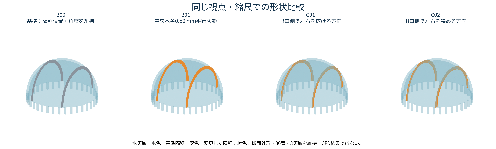
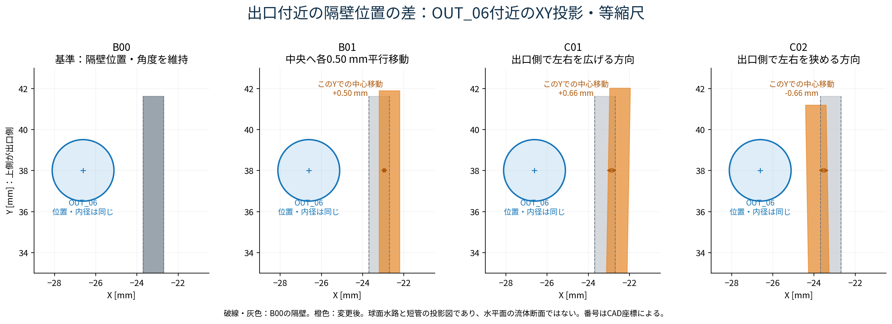
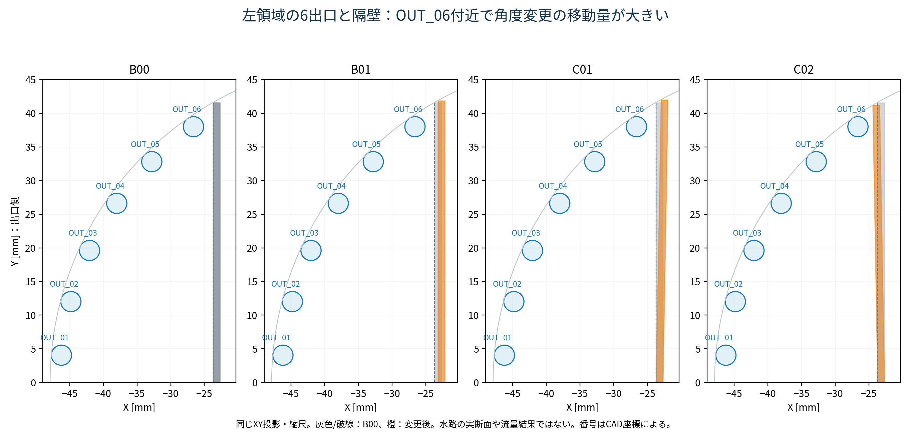

# B00・C01・C02のCFD比較準備、B01は次段階

今回は既存STEPから新規の体積メッシュを生成し、品質と条件を確認する段階です。流れのソルバーは実行しません。初期場の0/U・0/pは解ではなく初期・境界条件です。ケースのendTimeは0にしてあります。

## 形状の比較と仮説

| モデル | 変更 | 出口分配・低速域・損失について検証する仮説 |
|---|---|---|
| B00 | 基準 | 既存未収束結果を基準値と確定せず、新しい比較と同じ手順で計算する |
| B01 | 隔壁を中央へ各0.50 mm移動。中央を合計1 mm狭め左右を広げる | 左右で減速して低速域が増えるか、局所的な急流・抵抗が弱まり分配が変わるか。中央の損失増加と低速域の変化も確認する |
| C01 | 右隔壁+1°、左−1°。出口側で左右を広げる方向 | 接近方向・静圧回復が低流量出口を助けるか。減速・剥離で低速域や全圧損失が増える可能性もある |
| C02 | 右隔壁−1°、左+1°。出口側で左右を狭める方向 | 流れの掃き出しで低速域が減るか。摩擦増大や特定出口への集中で損失・偏りが悪化する可能性もある |

幅の増減は同じ位置のB00に対する変化です。3次元の球面流路を単純な直線拡大管・縮小管として扱いません。どの案も36短管、外形、3領域の分離を維持します。

CAD体積の領域別確認では、B01は左右の水容積がそれぞれ約2.03%増え、中央は約2.11%減ります。一方、C01/C02は各領域の容積差が約0.02%以内で、前後方向の形状分布を反転した対比較になります。この意味でも、容積・幅を変えるB01と、主に向き・前後分布を変えるC案を分けて調べる価値があります。これらは[CADの体積比較](geometry-volume-by-region.csv)であり、流量や低速域を計算した値ではありません。

CAD番号のOUT_01はY≈4.04 mm、OUT_06はY≈38.01 mmにあります。C案による左隔壁中心の移動量は、同じYで比較するとOUT_01付近で約0.071 mm、OUT_06付近で約0.664 mmです。B01はどちらも0.50 mmです。この違いから、角度変更はOUT_06付近の接近経路をより強く変えるという幾何学的な特徴があります。

検証する追加仮説は、C02でOUT_06近傍が狭まることで、その出口への流れやすさが抑えられ偏りが減るか、逆に流れが集中して増えるかです。C01は反対方向の比較です。これは投影上の位置から立てた仮説であり、有効流路抵抗や流量を計算した結果ではありません。静圧・全圧と速度方向を併せて調べます。[隔壁移動量のCAD幾何一覧](geometry-only-outlet-divider-offsets.csv)に値を保存しています。

STARの左右約33〜34%の出口偏りはユーザーの所見です。OpenFOAMの未収束B00保存場で確認した管入口寄りの全圧差・局所逆向き速度は手掛かりですが、STARの偏りを定量再現したとは言えません。全圧差には上流の運動量、接続損失、既に生じた流量差、未収束の影響が含まれます。

## 統一した条件

| 項目 | 準備した設定 |
|---|---|
| モデル | 等温・非圧縮・単相水の定常RANS、SST k–ω、重力なし、滑らかな壁 |
| 水物性 | 290℃・実圧15.5 MPa相当、ρ=746.2009559 kg/m³、ν=1.239443713×10⁻⁷ m²/s、μ≈9.24874×10⁻⁵ Pa·s |
| 温度の意味 | 一定物性を決める条件。エネルギー式・壁温・熱流束は今回扱わない |
| 入口 | 合計0.23 kg/sを18入口へ等分、各約0.0127778 kg/s。各領域の合計は約0.0766667 kg/s |
| 出口 | 18出口ともゲージ静圧0 Pa。絶対圧0ではない |
| 乱流・壁 | 入口乱流強度5%、混合長0.21 mm、noSlip、同じ壁関数 |
| 対流項 | 準備ファイルは速度linearUpwind、k/ωはupwind。提案する立上げ区間だけ速度upwind |
| 圧力速度連成 | SIMPLEC、圧力緩和0.2、速度・k・ω緩和0.3、非直交補正0、同じ制限付き勾配・ラプラシアン |
| 格子 | 同じ背景格子28×28×18、主水域level4、隔壁付け根から0.60 mm内level5、0.30 mm内level6。名目幅は約0.223/0.112/0.056 mm |
| 表面変換 | CAD mm→CFD mを一度だけ変換。全ソリッドを絶対許容差0.001 mmで三角形化し、面間の継ぎ目を合わせる |
| 隔壁付け根の細分化 | 各モデルの実際の付け根に同じ距離・格子幅の規則を適用。C案でも旧B00の位置だけに細分化を残さない |
| 境界層 | 明示的なプリズム層の生成なし。checkMeshのprismsというセル形状数は境界層を設計したことを意味しない。y+は流れを解くまで未評価 |
| 実行資源 | OpenFOAM v2412、4 MPI、CPU上限4、コンテナメモリ上限24 GiB。3ケースは逐次処理 |

物性、0の初期場・境界条件、解法設定、背景格子、監視点、監視間隔の一致を別途ハッシュで確認します。実際の格子点やセル数は形状で変わり、ケース間のセル番号は対応しません。同じセル数だけで同精度とは判断しません。既存B00のメッシュ・解は上書きせず、新しいB00も別ケースです。

今回の単相・重力なしの流動モデルは、水の構造比較用です。実験の気泡の浮上や二相流を解析したものではありません。

## 評価する6項目と記録方法

1. **18出口の質量流量：** ソルバーの面流束phi×ρから算出。各領域6本の合計、最大・最小、偏りD=(最大−最小)/平均×100%、CVを記録する。各領域の合計が等しいことは入口条件に強く拘束されるため、それだけを均等化の成果としない。
2. **OUT01とOUT06：** 左領域の差Δṁ=ṁ06−ṁ01、比ṁ06/ṁ01、差/6本平均を記録。CADの番号をSTARの番号と座標で照合する。右側は同じ位置関係の管も比較する。
3. **低速域：** 共通の内部球面r=45.2/46.4/47.6 mm、共通しきい値0.1/0.5/1 m/s未満で、面積・割合・位置を全体と領域別に比較。壁面速度0を低速域評価の主図にしない。各案の水領域全体と共通部分、新たに水・金属になった部分を分け、形状変更で元の低速部を埋めただけの効果を区別する。
4. **圧力損失：** 同じ管端位置で、同じ重み付けの全圧差を全体・領域別に算出。一定密度でp_t=p+ρ|U|²/2。OpenFOAMのpは動圧単位なのでρを掛けてPaに換算。入口平均静圧と全圧損失は別に記録し、静圧回復を損失低下と同一視しない。流束の符号と境界逆流時の重み付けを明示する。
5. **管への接近流れ：** 接続直前の水路の速度ベクトル・静圧・全圧と、管内Z=-1/-5/-9 mmの分布を比較。内部断面の順流・逆向き流量は速度からの積分値、出口境界の逆流はnative phiとして別に記録する。
6. **反復変化：** 残差、全体・各領域の収支、18出口の流量・静圧を10反復ごと、同一7864点の内部速度を20反復ごと、保存場を50または100反復ごとに確認。定常反復の横軸を物理時間と呼ばない。

流量・低速域・損失を併記し、一つの改善が他の悪化を伴っていないかを見る。未収束時はスナップショットの参考値に限定します。

## 提案する短い予備計算：今回未実行

今回の独立した追加幾何検査で、C01に小さいセル形状行列式のセルが6個見つかりました。通常検査の合格だけで流れ計算を開始せず、該当セルの位置と形状を確認し、格子を修正・再検査してから下記の予備試験へ進む方針です。C02を含む全ケースの検査結果はメッシュ品質の一覧に示します。凹形状や行列式だけから過去の未収束の原因を断定しません。

- 最初に**各20反復**で、初期化・境界条件・監視・実測時間/反復・メモリを確認する。この区間は20反復時点の場を保存してy+・壁面処理も確認し、その後は全ケース共通の保存間隔へそろえる。初期化方法は全ケース共通にする。
- 異常がなければ、各ケース**計200反復以内：一次精度100＋速度二次精度100**を予備試験とする。20反復はこの立上げ区間の一部に含める。ここで動作・更新量・分配への感度を見る。
- 200回で収束するという根拠はない。立上げ直後の変化や数値拡散で低速域が変わっても、形状の改善と結論しない。
- 定常解を評価する段階では、残差p<10⁻⁴、U/k/ω<10⁻⁵だけでなく、直前100反復の内部速度変化・低速域位置・各出口流量の安定を同時に確認する。前回と同じ数値基準を使う場合、速度相対L2<1%、各出口流量範囲/平均<0.1%、質量収支誤差<0.1%、低速点のIoU≥0.95などを併用する。これらも格子独立性や真の誤差の保証ではない。
- 現在の壁面近傍・凹形状セル・非直交補正への感度は残る。設定を変える試験は別ケースにし、全形状で同じ方法を使う。
- 定常解が落ち着かない場合の長いURANSや追加反復は、必要資源と観測時間を整理して確認後に進める。

## 予想セル数・メモリ・時間

メッシュ生成前の見積は、各ケース4.5〜6.5百万セル、1ケースずつの実行で16〜24 GiBを確保する計画です。B01は未生成なのでこの範囲の見積のままです。B00・C01・C02の実セル数と実測メッシュ生成時間・メモリは[メッシュ検査結果](mesh-quality/mesh-summary.csv)で置き換えて示します。

流れの計算時間は今回実測していません。以前の約500万セル・4 MPIのB00/A01のログでは約9〜12秒/反復であったため、同程度なら20反復は約3〜5分、200反復は約30〜40分/ケースです。初期化・保存・再構築の余裕を含め、**各200反復で約30〜50分、3ケース逐次で約1.5〜2.5時間**を目安とします。ハードウェア、圧力反復、格子品質で変わるため、最初の20反復で更新します。500反復でも収束保証はありません。

[以前の正常終了ログから抽出した実測参照値](historical-flow-runtime-reference.csv)は、100反復の立上げと400反復の後続計算について約9.95〜10.96秒/反復でした。今回のC01/C02の速度を実測した値ではありません。

同時に3ケースを走らせる計画ではありません。流れの解は複数時点の保存でディスク消費が増えるため、保存間隔・世代数・残容量を確認してから実行します。ネイティブメッシュと将来の保存場を含む大容量一式は、図とログの配布ZIPとは分けます。

約500万セルのU/p/phi/k/ω/nut一式は、非圧縮のバイナリ概算で約0.4 GB/保存時点です。並列データと再構築データを両方保持すると増え、3ケースの初期化・複数時点の保存だけでも数GBになります。既存成果を削除しない条件を守り、開始前に残容量と保存計画を確認します。長時間の計算では追加の保存先を用意することも検討します。

格子修正でセル数が変わった場合は、上の時間・メモリ・保存容量の見積も更新します。
