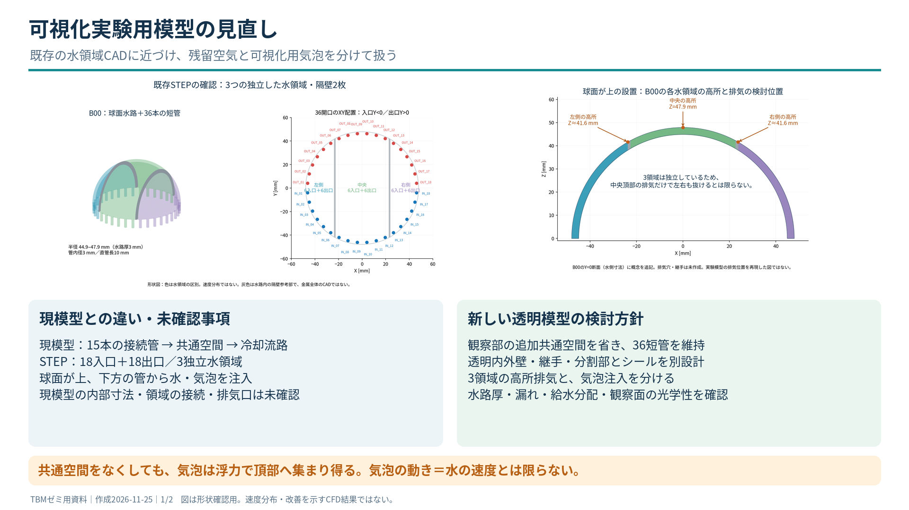
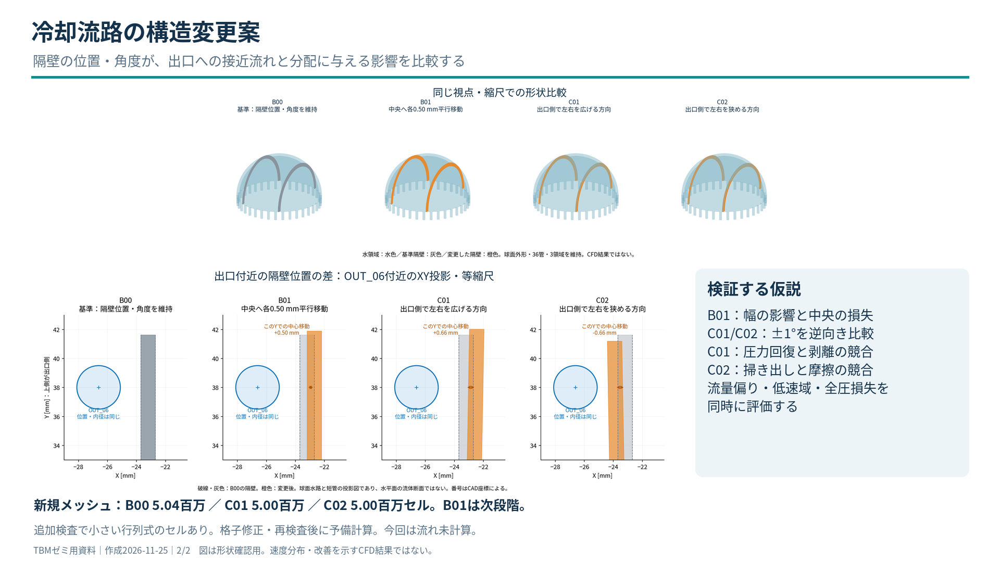

# TBMゼミ資料：透明模型の見直しと構造変更の比較準備

作成日：2026年11月25日。**画像・2枚のスライドと、新規B00/C01/C02のメッシュ生成・品質確認を完了しました。流れのCFD計算は実行していません。** 元のCAD・既存メッシュ・既存結果は保全しています。

## ゼミ用の2枚

- [PowerPoint：2枚、本文テキストと図・発表ノート](slides/TBM-seminar-2slides.pptx)
- [PDF：2ページ](slides/TBM-seminar-2slides.pdf)
- [スライド1 PNG](slides/slide-1.png)、[スライド2 PNG](slides/slide-2.png)
- [発表時の説明例](speaker-notes.md)

### スライド1：可視化実験用模型の見直し

B00は18入口＋18出口、3独立水領域、隔壁2枚からなる水領域CADです。説明された実験模型の追加15接続管・共通空間は含みません。実験模型は球面が上で、下方の管から水・気泡を入れるとの説明に基づいて整理しました。内部の実際の流速方向を測定した情報ではありません。内部寸法・接続詳細・排気口は未確認として区別しました。

透明模型には内外壁・継手・分割/密閉・領域間漏れ防止を別途設計する必要があります。共通空間を除いても気泡は浮力で頂部へ集まり得ます。残留空気の排出と可視化用気泡の注入、気泡と水の速度を区別します。製作用CADは今回作成していません。

[実験模型と透明容器の詳細検討](experiment-model-design.md)。

### スライド2：冷却流路の構造変更案

B01は中央へ各0.50 mm平行移動、C01/C02は±1°の逆方向の回転です。B00・B01・C01・C02を同じ正投影の視点・縮尺で並べ、OUT_06付近の投影図で隔壁位置の差を拡大しました。図の色は水・隔壁の区別で、CFDの速度ではありません。

## メッシュ品質とCFD準備

通常検査は通過しましたが、追加検査で凹形状セルに加えて、小さなセル形状行列式のセルが見つかりました。該当セルを修正・再検査してから構造比較の予備計算へ進む必要があります。今回のメッシュを性能評価用に準備完了とは扱いません。

| モデル | 実セル数 | 通常検査 | 追加検査 | 凹形状セル | 小さい行列式のセル | 最大非直交角 | 最大スキュー |
|---|---:|---|---|---:|---:|---:|---:|
| B00 | 5,037,651 | 合格 | 未合格 | 68,027 | 0 | 59.17° | 3.022 |
| C01 | 4,997,954 | 合格 | 未合格 | 71,398 | 6 | 65.00° | 3.161 |
| C02 | 4,997,775 | 合格 | 未合格 | 71,425 | 6 | 65.00° | 3.229 |

B01は画像比較・既存CADの確認までで、今回のメッシュ生成対象には含めていません。壁面y+・流れの収束・18出口流量・低速面積・全圧損失は今回未評価です。初期場を結果として表示していません。

[実測メッシュ品質と必要資源](mesh-quality/README.md)、[物性・境界条件・6評価項目・予備計算の計画](CFD-comparison-plan.md)。

品質問題の修正・再検査後の予備計算は各20反復で動作・資源を確認し、その後は計200反復以内（一次100＋二次100）を提案します。以前の約500万セル・4 MPIのログから、各200反復で約30〜50分、3ケース逐次で約1.5〜2.5時間を見込みます。今回は未実行です。長時間のCFDは確認後に進めます。

## 個別の高解像度図

- [B00全体図と36開口](figures/B00-overview-and-ports.png)
- [B00の実CAD断面・隔壁付け根](figures/B00-real-CAD-section.png)
- [各水領域の高所と排気の検討位置](figures/B00-high-point-vent-concept.png)
- [4モデルの同じ視点・縮尺の比較](figures/four-models-same-view.png)
- [出口付近の隔壁位置・幅の比較](figures/divider-outlet-detail.png)
- [OUT01〜06と隔壁の位置関係](figures/outlet01-to06-geometry-context.png)
- [生成した出口端面メッシュの比較](figures/native-outlet-mesh-check.png)
- [追加検査の問題セルの位置](figures/quality-cell-locations.png)
- [実験模型と新模型の接続関係の概念図](figures/experiment-model-concept.png)

[領域別のCAD水容積](geometry-volume-by-region.csv)も確認しました。B01は左右の容積を約2.03%増やし、中央を約2.11%減らします。C01/C02は各領域の容積がほぼ同じで、前後の形状分布を逆向きに変える比較です。これは流量の計算値ではありません。

## 再現性と保全

既存STEP・以前の解析結果は変更していません。入力のハッシュ、共通条件の一致確認、メッシュ生成と品質検査の全ログ、実際に使ったスクリプトを同梱します。元STEPのソースは既存 `cad-proposals-20261120/water/` です。大容量の体積メッシュ・表面STLは配布ZIPには含めず、作業環境に保持します。既存保存解のコピーや追加の流れの計算は行っていません。
