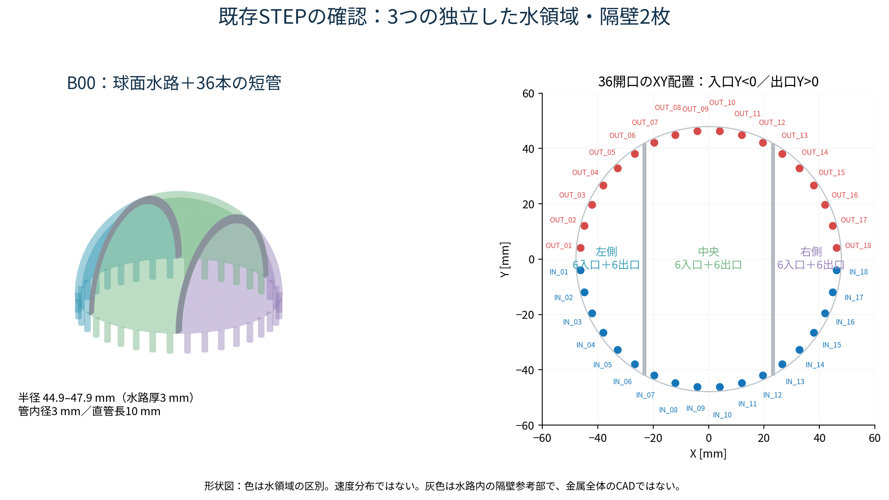
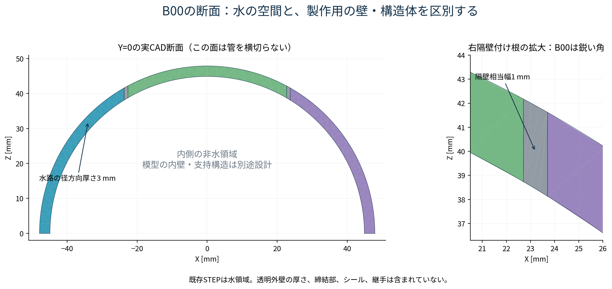
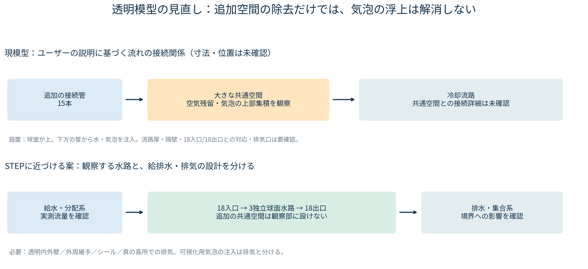
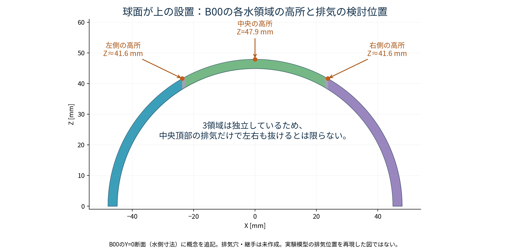

# 可視化実験用透明模型の検討

## 確認できた構造

B00のSTEPを再読込みして可視化しました。水が占める空間は、球面内外半径44.9/47.9 mmの水路と、内径3 mm・直管長10 mmの36短管からなり、隔壁2枚で3つの独立した水領域に分かれています。各領域に6入口・6出口があります。入口はY<0、出口はY>0、短管端はZ=-10 mmです。

このSTEPには、実験模型について説明された「15本の接続管を通じて入る大きな共通空間」はありません。内径3 mmの36短管とは区別します。既存STEPは水領域のCADであり、そのまま印刷すれば密閉できる透明容器になるというものではありません。

## 実験模型について確認された点と未確認の点

| 項目 | 既存B00 STEP | 実験模型について今回分かっていること |
|---|---|---|
| 水の入口経路 | 18入口短管から各水領域に直接つながる | 説明では15本の接続管→大きな共通空間→冷却流路 |
| 共通空間 | 3水領域を連通する共通空間はない | 存在する。寸法、形状、3領域との接続位置は未確認 |
| 設置向き | CAD座標は球面が+Z、管が-Z | 球面が上と回答。下方の管から水が上に入るとの認識で、内部の実際の流速方向を測定した情報ではない |
| 気泡 | この単相水のCADでは気相を定義していない | 管から気泡を入れ、球面での動きを見る。空気残留と上部への気泡集積を観察 |
| 流路厚・隔壁 | 3 mmの径方向水路、1 mmの最小隔壁相当幅 | 実験模型の実寸、隔壁・継ぎ目・漏れの状態は未確認 |
| 管番号 | CAD座標でIN/OUT各01〜18 | 実験模型の接続管とCAD番号の対応は未確認 |
| 排気 | 排気用部品はSTEPに含まれていない | 排気口の有無と位置は未確認 |

実験模型の図は説明に基づく接続関係の概念図です。未入手の実験模型CADから寸法・断面を再現した図ではありません。

## 共通空間をなくす場合の設計方針

観察部はB00に近い球面水路とし、追加の共通空間とその15本の接続管を省く案を検討できます。ただし元の18入口・18出口の短管への接続、給水分配、排水集合は別途必要です。36短管自体をなくす案ではありません。

給水・集合系は観察部から分け、余分な気体の溜まりや大きな段差をできるだけ作らない配置を検討します。外部配管が各入口流量・各出口圧力を変えるため、単に共通空間を消すだけで既存CFDと同じ境界条件にはなりません。CFDでは18入口に等しい流量を与えていますが、実験の共通給水では自然な分配です。個別流量・領域合計流量と入口出口圧力を測り、比較条件を記録します。

### 透明容器として必要な部品

- **内壁・外壁と隔壁：** 水路の内半径44.9 mm・外半径47.9 mmを水側寸法として保持する。壁厚はこの3 mmとは別の設計値。水領域を材料として印刷するのではなく、材料側の形状に水領域を空洞として反映する。
- **分割・組立：** 透明内側コア、外側シェル、底面の接続部などに分ける方法を候補とする。狭い閉流路は残留樹脂や支持材の除去、内面の研磨が難しいため、製造方法を決めて分割を選ぶ。分割面や締結部は可能な範囲で観察領域から外す。
- **3領域の密閉：** 外部への漏れだけでなく隔壁合わせ目の領域間漏れを防ぐ。連通すると3独立領域というCFDの前提が変わる。各領域を分けた漏れ確認が必要。
- **継手：** 内径3 mmの水側流路と10 mm直管部の基準を保ち、外側で継手・ホースを支持する。水側に継手の段差や接着剤がはみ出さない構成を検討する。外部配管の抵抗も測定境界に含めて整理する。
- **シール：** 底面やシェル合わせ目にガスケット、Oリング、接着などの候補がある。締付けによる水路厚変化、合わせ目の段差、気体ポケット、透明性、再分解の必要性で選ぶ。現時点では溝寸法や製作方法を確定しない。
- **観察性・寸法精度：** 透明樹脂を印刷しても、内面粗さ・積層・黄変・屈折で気泡が明瞭に見えるとは限らない。3 mmの水路厚、1 mm隔壁と公差を確認し、試作片で透明性と洗浄・仕上げ方法を確かめる。

実験時の温度・圧力と材質・壁厚は別に設定します。CFDの290℃・15.5 MPaという水物性条件を、そのまま透明樹脂模型の使用条件にはしません。実験とCFDを定量的に比較する場合は、温度に応じた粘度・Re、流量、粗さ、気泡の条件も記録します。

## 気泡観察のための排気と注入

球面が上の設置では、共通空間を除いても気泡は浮力で上部へ集まり得ます。水が球面から出口へ向かって下がる部分では、気泡の浮上と水の流れが反対になることがあります。気泡の動きは水の速度と気泡の相対運動を合わせたもので、単相CFDの水速度をそのまま可視化する受動トレーサーとは限りません。

1. 初期充填時の残留空気を抜くことと、観察用の気泡を意図的に注入することを分ける。
2. 各独立水領域の実際の高所に、閉止可能で余分な空間を小さくした排気手段を検討する。B00は中央と左右で高所の位置・高さが異なるため、中央頂部の排気だけで3領域の空気を抜けるとは限らない。
3. 低い位置からゆっくり満水にし、残留空気を抜いてから、注入量・気泡径・注入口を定めて観察する。
4. 測定中に排気口を開けるか閉めるか、気泡の蓄積前のどの時間を比べるかを決める。開放排気は流量・圧力条件を変え得るため、記録する。
5. 水の低速域と気泡の集積を同一視せず、必要なら水の速度を別の方法で測定し、対応を確認する。

水側CADの高所は、中央がZ=47.9 mm、左右が約Z=41.6 mmです。図は既存B00の寸法に排気の検討位置を重ねた概念図であり、実験模型の排気口の位置を再現した図でも、加工用の排気穴を設計した結果でもありません。

特に左右の高所は隔壁と球面壁の付け根近傍です。図の最高点をそのまま孔中心にせず、高所近傍で他の水領域へ抜けないように孔径・残肉・継手・シールを設計します。空気残留や気泡付着の原因を共通空間だけに断定せず、注入量・気泡径・観察時間・表面状態も記録します。

これらは設計方針で、3Dプリント用の製作CADや耐圧・密閉性能を検証した結果ではありません。今回は製作用の新しいCADを作成していません。
