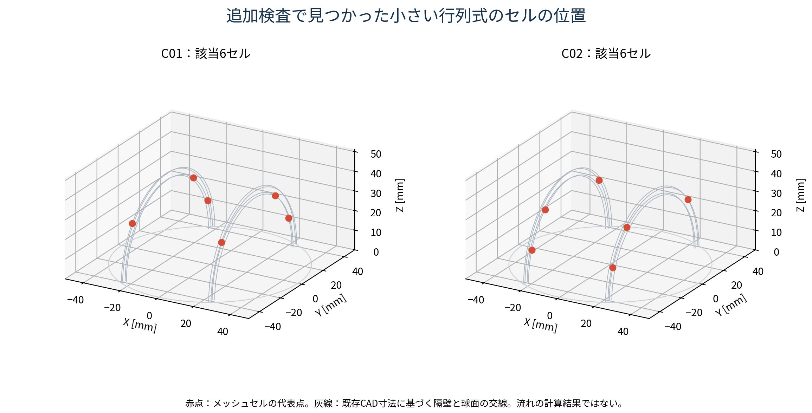

# 新規メッシュの実測結果

既存B00/C01/C02 STEPから、新規ケースで生成したメッシュです。旧CAD・旧メッシュ・旧計算結果を上書きしていません。流れは計算していません。

**通常検査は通過しましたが、追加検査で凹形状セルに加えて、小さなセル形状行列式のセルが見つかりました。該当セルを修正・再検査してから構造比較の予備計算へ進む必要があります。今回のメッシュを性能評価用に準備完了とは扱いません。**

| モデル | 実セル数 | 通常検査 | 追加検査 | 凹形状セル | 小さい行列式のセル | 最大非直交角 | 最大スキュー |
|---|---:|---|---|---:|---:|---:|---:|
| B00 | 5,037,651 | 合格 | 未合格 | 68,027 | 0 | 59.17° | 3.022 |
| C01 | 4,997,954 | 合格 | 未合格 | 71,398 | 6 | 65.00° | 3.161 |
| C02 | 4,997,775 | 合格 | 未合格 | 71,425 | 6 | 65.00° | 3.229 |

全ケースで水領域3、cellZone3、境界パッチ37（壁＋36開口）、36開口すべての面数と面積が正であること、最小セル体積が正であることを確認しました。3領域は設計上の独立水路です。領域数が3であることを欠陥とは扱いません。

CAD体積に対するネイティブメッシュ体積の誤差はB00 -0.041%、C01 -0.041%、C02 -0.041%です。管端開口面積のCADに対する絶対誤差の最大値はB00 0.63%、C01 0.63%、C02 0.63%でした。モデル間の管端面積差も出口分配比較の数値的不確かさとして確認する必要があります。STL変換の体積検査も各ケースに記録しました。

新しいB00に対する管端面積のモデル間差の絶対値の最大は、C01 0%、C02 0%でした。これは各案とCADとの誤差とは別の比較です。[モデル間の開口比較](matched-port-geometry.json)に保存しています。これが小さくても内部格子の違いや格子独立性の検証を置き換えるものではありません。

明示的なプリズム境界層は生成していません。y+は流れを解くまで求められません。凹形状セルや非直交角だけから未収束の原因を特定せず、位置・壁面処理・格子感度を別に確認します。共通の設定でも各形状の格子品質は同じとは限りません。

小さい行列式の検査基準は0.001です。体積が負という意味ではなく、形状がつぶれたセル等を検出する指標です。少数でも比較の数値誤差や不安定化の懸念があるため、位置を確認し、隔壁付近の格子遷移や特徴線へのスナップなどを新規ケースで調整して再検査します。スナップ処理の最終エラー数0だけを合格条件とせず、独立した全幾何検査も確認します。この問題だけで、以前のB00やSTARの未収束原因を特定したとは言えません。

[問題セルの位置と根元への距離](small-determinant-cell-locations.csv)、[位置の集計](small-determinant-cell-location-summary.json)も保存しました。抽出したVTUのcellIDは部分メッシュ内の番号で、元のグローバルセル番号と同一視していません。元のcellSetも別に保持しています。抽出したのはセル形状だけで、速度・圧力の場は含めていません。

## 資源と時間

| モデル | セル数 | メッシュ生成＋再構築＋検査 | コンテナメモリ | 将来の200反復 |
|---|---:|---:|---:|---|
| B00 | 5.038百万（実数） | 25.9分（実測） | 8.56 GiB（5秒間隔の観測最大） | 約30〜50分（未実行・既存ログからの見積） |
| C01 | 4.998百万（実数） | 28.4分（実測） | 9.99 GiB（5秒間隔の観測最大） | 約30〜50分（未実行・既存ログからの見積） |
| C02 | 4.998百万（実数） | 28.2分（実測） | 11.15 GiB（5秒間隔の観測最大） | 約30〜50分（未実行・既存ログからの見積） |
| B01 | 約4.5〜6.5百万（見積、未生成） | 類似規模を想定、未実測 | 実行時16〜24 GiB確保を想定 | 約30〜50分（未実行・見積） |

メッシュ生成・品質検査の終了時点までに記録したコンテナの累積cgroup memory.peakは11.26 GiBでした。これはページキャッシュを含み、個々のプロセスRSSの合計ではありません。各ケースの5秒間隔の観測最大と、終了時点の累積ピークを区別しています。コンテナ上限は24 GiB、CPU上限4、4 MPIで逐次処理しました。流れの計算には格子生成と異なるメモリが必要なため、1ケース16〜24 GiBを確保し、最初の20反復で実測を更新する案です。

メッシュ生成時間は画像作成なども並行したこの環境での実測で、単独実行や別の計算機の所要時間を保証する値ではありません。

流れの実行時間は今回測っていません。以前の約500万セル・4 MPIのログの約9〜12秒/反復から、初期化・保存等を含め200反復は約30〜50分/ケース、3ケース逐次で約1.5〜2.5時間を見込みます。ハードウェアや線形反復数で変わります。

## 次の試験に進む条件

今回はメッシュ生成・検査までです。上記の品質問題を修正・再検査してから、各20反復で動作・資源確認後、一次100＋二次100の計200反復以内を予備試験として提案します。未収束の短い計算の面積差は改善の確定値としません。長時間の定常継続やURANSは確認後です。

メッシュのネイティブ本体は作業環境 `/workspace/scratch/tbm-seminar-prep-20261125/B00`、`C01`、`C02` にあります。配布ZIPには大容量polyMesh・triSurfaceを含めず、条件・メタデータ・全メッシュログ・品質集計・36開口の幾何検査を含めます。

[数値一覧CSV](mesh-summary.csv)、[詳細JSON](mesh-summary.json)、[共通条件の一致確認](matched-input-validation.json)。
