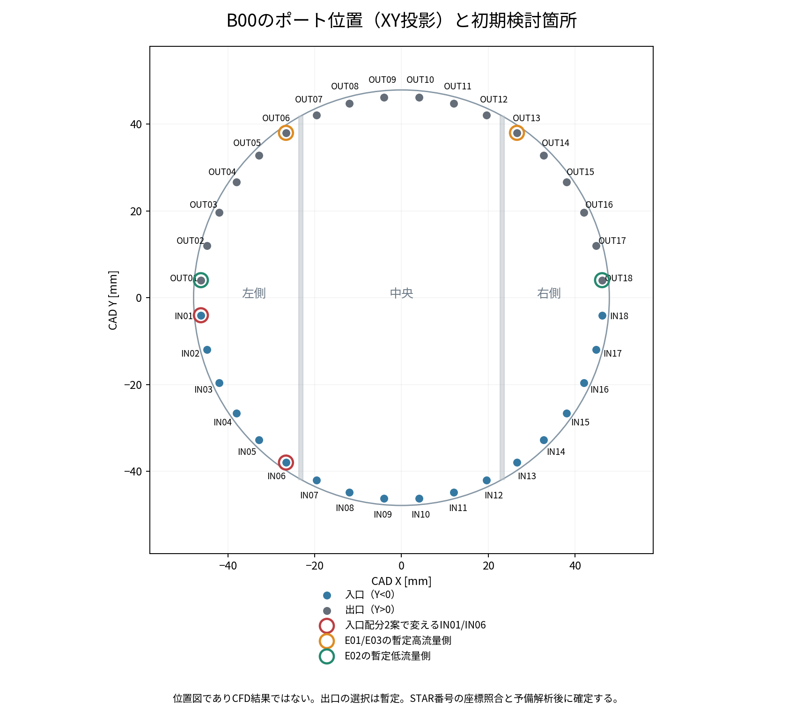

# 構造変更・入口配分の予備解析計画（確認用、2026年11月27日）

**最初はB00・C01・C02と、B00の2入口だけを±10%変更するI01・I02の計5ケースに絞る。** 既存メッシュと20反復の保存場を再利用し、まず同じ100反復までの分布・出口流量・損失を比較する。残差目標の達成だけを待って構造比較を止める方針にはしない。一方、起動中の変動より小さい差には順位を付けない。出口管の案は、その結果とSTAR側の位置対応を見てから1案を選ぶ。

今回は実ファイル・ログの確認と計画資料作成のみ。**新しいCAD、メッシュ、ソルバーケースは作成せず、CFDも実行していない。大規模計算は計画確認後に行う。**

## 1. 確認できた進捗と再利用するもの

修正済みの全体3領域ケースは`/workspace/scratch/tbm-mesh-repair-20261125/{B00_R07,C01_R07,C02_R07}`にある。ログの反復ラベル1〜20と正常終了を確認し、各ケースの20/U,p,k,omega,nut,phi.gzが残っていることを確認した。24のnativeメッシュファイルと18の保存場について、11月25日の公開記録とのハッシュ一致も確認した。

| モデル | セル数 | 小さい行列式のセル | 最小行列式 | 実施済み反復 | 20反復の実時間 |
|---|---:|---:|---:|---:|---:|
| B00 | 5,037,651 | 0 | 0.0048215023 | 20 | 7.41分 |
| C01 | 4,997,954 | 0 | 0.0011 | 20 | 7.44分 |
| C02 | 4,997,775 | 0 | 0.0011 | 20 | 9.46分 |

- C01・C02の各6セルは内部頂点の調整R07で除去済み。CADと物理境界は変更していない。**再メッシュと同じ20反復の再実行は不要。** R07はメッシュ修正番号で、新しいCAD案ではない。
- 通常検査は3モデルとも合格。詳細検査では凹形セルがB00で68,027、C01で71,398、C02で71,425残る。解像度・壁面処理・メッシュ依存性の検証が済んだ意味ではない。
- 最新の3領域・約500万セルのケースに100/200反復の完了ログや保存場は見つからない。20反復から継続する計画とする。
- 旧B00左側領域1,264,925セルでは、一次精度2000反復、二次精度2600反復までの診断がある。未収束だったこの試験を繰り返さず、最新の全体3モデルの同条件比較とは分ける。
- A01の旧500反復比較も別の履歴であり、今回の5ケースの対照として混ぜない。

根拠：[11/25メッシュ修正・試運転](../mesh-repair-pilot-20261125/README.md)、[旧左側領域の長い診断](../cfd-steady-ramp-20261121/README.md)、[今回の監査記録](current-file-audit.json)。

## 2. 最初の5ケース

| ケース | CAD形状 | 入口条件 | 調べたいこと |
|---|---|---|---|
| B00 | 元の基準構造 | 全18入口が等流量 | 共通の比較基準 |
| C01 | 既存±1°隔壁、出口側の左右領域を広げる | B00と同じ | 出口付近の幅増加で主流方向・分岐・圧力回復がどう変わるか |
| C02 | C01と逆方向の既存±1°隔壁 | B00と同じ | 局所加速による低速域低減と、抵抗・剥離増加のどちらが現れるか |
| I01 | B00そのまま | IN01を+10%、IN06を−10% | 左側外周側からの流入を強めたときの流れと配分の応答 |
| I02 | B00そのまま | IN01を−10%、IN06を+10% | 逆方向の摂動。応答の方向・非対称性を調べる |

隔壁回転は出口付近だけでなく入口直後の内部流路幅も変える。C01の側部は入口側が狭く出口側が広がり、C02はその逆になる。入口管の径・流量は変わらないため、管入口の平均速度を変える案とは区別する。中央領域への影響も併せて評価する。

C01は流路を広げるので必ず改善、C02は狭めるので必ず悪化、とは予測しない。拡大で減速や剥離が増える場合、狭まりで速さが上がっても損失や他の低速域が増える場合がある。**最初は形状と入口変更を組み合わせない。**

### 入口流量の具体値

基準1本は0.23/18 = **0.0127777778 kg/s（12.7778 g/s）**。

| ケース | IN01 | IN06 | 他の16入口 | 合計 |
|---|---:|---:|---:|---:|
| B00/C01/C02 | 0.0127777778 | 0.0127777778 | 各0.0127777778 | 0.23 kg/s |
| I01 | **0.0140555556** | **0.0115000000** | 同上 | 0.23 kg/s |
| I02 | **0.0115000000** | **0.0140555556** | 同上 | 0.23 kg/s |

IN01は左側外周端寄り（x≈−46.223、y≈−4.044 mm）、IN06は左側隔壁寄り（x≈−26.614、y≈−38.009 mm）。2本だけを変え、左側6入口の合計も0.0766667 kg/sに保つ。中央・右側の入口は変更しない。これにより、領域間の総流量変更と領域内の配分変更を混同しない。

[全18入口の提案値](inlet-flow-proposals.csv)と[領域ごとの合計](inlet-region-balances.csv)を作成した。合計は有理数で検算しており、CSVは小数表示による丸めを含む。**設定にはまだ適用していない。**

IN01を増やせばOUT01だけが増える、という一対一の流路は仮定しない。接続した水領域内で圧力と運動量が再分配される影響を調べる。実験でこの配分を与える場合は各管の流量調整・計測が必要であり、共通水室から自然にこの配分になると仮定しない。有望なら、右側の対応するIN18/IN13にも同じ変更を反映する追加案を検討する。

## 3. 出口管案と適用対象

全ての案で、出口を指定流量境界にしない。入口合計0.23 kg/s・18入口等分を維持し、全出口にゲージ静圧0を与え、形状抵抗による自然な流量分配を調べる。出口管案は**B00を基準**にし、I01/I02の条件やC01/C02の形状を同時に加えない。

| 案 | 変更箇所・量 | 暫定対象 | 流量偏り・低速域への仮説 | 圧損・製作上の論点 |
|---|---|---|---|---|
| **E01：外部抵抗管** | 内径3 mmを維持し、選択した直管長10→20 mm | 高流量側とされるOUT06/13 | 高流量側を抑え他出口へ回す可能性。ただし内部低速域は増える場合もある | 摩擦抵抗は増える。TBM球面本体を変えず外部交換部品として試しやすい。外部10 mm延長の設置可否は要確認 |
| **E02：低流量側を拡径** | 選択した管の内径3.0→3.2 mm、直管長10 mmを維持 | 低流量側とされるOUT01/18 | 低流量側の抵抗を下げ、配分と圧損を両立できる可能性 | 管接合部の流れも変化する。入口・出口の位置と球面本体は維持するが、対象の開口径は意図的に変える。金属側の残り肉厚・接続寸法は水領域STEPだけでは確認できない |
| E03：高流量側を絞る | 内径3.0→2.8 mm、直管長10 mmを維持 | 高流量側のOUT06/13 | 流量を抑制するが、絞りの高速部や新しい滞留部ができる可能性 | 損失増大、寸法公差、接続形状に注意。初期に一括実行せず、必要時の第3候補 |

製作・比較のしやすさからE01を最初の候補とするが、圧損の増大を避ける方向のE02も残す。両者は同じ効果を保証する案ではなく、反対の抵抗調整方針を比較する候補である。まず1案に絞ってCAD・メッシュ・20反復へ進む。

### 対象出口は現時点で確定しない

先生との検討でのSTAR結果は「OUT06がOUT01より高流量」である。一方、最新20反復ではnative番号の大小が逆で、旧500反復の別メッシュでは再びOUT06側が高い。

| CAD出口 | (x,y) mm | 最新B00・20反復 [g/s] | 旧B00・500反復 [g/s] |
|---|---|---:|---:|
| OUT_01 | (-46.223, 4.044) | 13.950 | 11.615 |
| OUT_06 | (-26.614, 38.009) | 12.141 | 13.137 |
| OUT_13 | (26.614, 38.009) | 12.125 | 13.127 |
| OUT_18 | (46.223, 4.044) | 13.947 | 11.661 |

旧500反復と最新20反復はメッシュ・数値履歴が異なるため、反復数だけの対照実験ではない。これだけで「20→500で順位が必ず反転する」と断定しない。STARのOUT番号とCADのx/y座標の対応も未照合である。

B00の偏りの方向と低速域の大まかな位置がSTARの既存結果と合うかも確認する。合わない場合は、OpenFOAM内の条件感度として記録し、実験模型の改善候補が確定したとは扱わない。

したがって、**STARの実管位置と座標を照合し、100反復等の共通履歴で持続して高流量／低流量となる位置を確認してからE案の対象を固定する。** 20反復の一枚だけに合わせて抵抗を足さない。根拠データは[outlet-target-provenance.csv](outlet-target-provenance.csv)。

### 抵抗変化の大きさの概算

ρ=746.2009559 kg/m³、ν=1.2394437×10⁻⁷ m²/s、1本の基準流量0.0127778 kg/sとすると、D=3 mmでV≈2.42 m/s、Re≈5.86×10⁴。滑らかな十分発達した乱流の概算として、Darcy係数f=0.3164 Re⁻⁰·²⁵、Δp=f(L/D)ρV²/2を用いる。

| 内径 [mm] | 基準流量での速さ [m/s] | L=10 mmの摩擦損失 [Pa] | L=20 mmの摩擦損失 [Pa] |
|---|---:|---:|---:|
| 2.8 | 2.781 | 206 | 412 |
| 3.0 | 2.423 | 148 | 297 |
| 3.2 | 2.129 | 109 | 218 |

L=10 mmは約3.3Dと短く、実際には入口・曲がり・剥離・縮拡大の損失が重要である。この表は**CFD結果でも最適寸法でもない**。長さを2倍にしても全流路の抵抗が2倍になるわけではない。D=3 mmの10 mm追加で増える分布摩擦は約148 Paで、以前の入口静圧約3.3 kPaに比べると数%の規模にとどまる。入口静圧3.3 kPaを管単独の駆動圧差と仮定して流量を逆算しない。

E01では管末端がz=−10 mmから−20 mmへ移る。新しい管が背景格子の範囲外にならないよう、下側の計算領域を拡張し、球面内部の格子間隔・格子位相・局所細分化規則をできるだけ維持する。単に背景格子の範囲だけを広げて全体を粗くしない。新メッシュでは品質指標を再検査し、旧R07の頂点番号をそのまま適用せず不良箇所を再検出する。

径変更では、分布摩擦だけでなくKρV²/2の局所損失も変わる。Kは未同定であり、流量偏り約33〜34%がこの小変更だけで解消すると保証しない。長さ変更は圧力出口の位置も動かすため、共通の管根元断面と実際の出口で損失を分けて確認する。必要なら全出口を一様延長した境界位置の対照も追加する。実験では出口高さや下流配管抵抗をそろえる。

## 4. 共通の計算・評価条件

- OpenFOAM v2412、定常simpleFoam、非圧縮等温水、SST k–ω、290℃・15.5 MPa相当の一定物性を維持する。合計0.23 kg/s、圧力出口0ゲージ、壁no-slip、既存の緩和・勾配制限等をそろえる。
- 初期スクリーニングは既存20反復と同じ一次風上。比較中にケースごとに離散化を変えない。一次風上の数値拡散を構造改善と見なさず、選んだ候補とB00を同じ二次精度で再確認するか、STARの同一設定で検証する。
- B00/C01/C02は各自の20反復保存場から継続する。I01/I02は同じB00メッシュ・同じ元の一様初期場から開始し、各20反復を実施する。B00の途中場を流入変更ケースだけに流用しない。全ケースを20で区切ってから同じ100まで進め、比較の履歴をそろえる。
- 各領域の入口合計がほぼ等しいこと自体は境界条件による。評価するのは各領域内の6出口分配と内部の流れである。中央・右側の物理入力はI案で変わらないが、未収束の数値更新まで完全に同じになるとは仮定しない。

| 評価項目 | 定義・記録方法 |
|---|---|
| 出口流量 | native面流束phi×ρ。18本と領域内6本の(max−min)/平均、CV、左OUT06−OUT01、右OUT13−OUT18の符号付き差を保存 |
| 低速域の面積・位置 | 主評価は内部球面r=46.4 mm、\|U\|<0.5 m/sの面積率。0.2 m/sとr=45.2/47.6 mmを補助評価として先に固定。壁面そのものは対象にしない |
| 面積の比較 | 等面積サンプリングまたは三角形面積で加重する。モデル固有の水面積での率と、全モデルに共通する水領域マスクでの率を併記。形状変更で増減した水領域の面積も別記し、点の単純割合を面積率と呼ばない |
| 低速域の位置 | 同じ視点・縮尺・カラー範囲（例0–1.5 m/s、上限超過を明記）で図示。低速マスクの重なりと領域別面積を記録し、色だけで判定しない |
| 損失 | OpenFOAMのpはp/ρ。全圧p_t=ρp+ρ\|U\|²/2の流量重み付き入口−出口差と、静圧差を分ける。逆流は順・逆流量を併記して扱う |
| 水力動力 | Q_tot Δp_t。入口配分変更で入口の運動エネルギー流束も変わるため、入口平均静圧だけで有利と判定しない。外部弁・流量調整器の損失は別 |
| 出口管への流入 | 管根元付近の同じ位置の断面（例z=−1 mm）と直前領域で速度ベクトル、静圧、全圧を見る。径変更では断面積も記録 |
| 反復による変化 | 各管流量・圧力を毎反復、内部速度・薄い評価面を10反復ごとに保存。100時点では50–100等の同じ反復窓の代表値と範囲を比較 |
| 起動の健全性 | 正常終了、有限値、乱流量の符号、全体・領域別収支、極端な速度増大、メモリを確認。残差の単一しきい値達成を構造比較開始の必須条件にはしない |

反復窓で計算する代表値は**数値反復に対する要約**であり、物理的な時間平均ではない。順位が窓によって反転する、差が反復変動と同程度である場合は「優劣未確定」とする。低速面積、出口のCV、全圧損失のPareto関係から次候補を選び、総合点の重みを結果に合わせて変更しない。圧損+5%を仮の比較目安として表示する案はあるが、確定の合否基準ではなく相談して決める。

## 5. 最も効率的な実行順序（全て実行前に確認）

1. **今回完了：既存成果の監査と計画作成。** 既存の品質修正・全体20反復・旧長反復診断を重複しない。
2. **承認後の短い初回：I01/I02のみ各20反復。** CAD・メッシュを新規生成せず、B00メッシュを保護して再利用。既存B00の20反復と起動の健全性・コストを比べる。純ソルバー約15分、入出力を含め20〜30分を目安とする。この段階で改善案を決定しない。
3. **構造変更を優先：B00/C01/C02を20→100へ各80反復追加。** 約26/25/35分（純ソルバー）。同じ評価方法で構造による変化を図表化する。
4. **入口感度：I01/I02も20→100へ追加80反復。** 各約26分。B00を再実行せず、同じ100時点と50–100の窓で5ケースを比較する。
5. **必要な場合だけ：B00と候補を100→200へ継続。** 自動で全案を長時間回さない。差が反復窓に埋もれる場合は未確定とし、予算内で傾向が持続するか確認する。残差原因の追究だけへ戻ることを既定路線にしない。
6. **出口管は第2段階：対象位置と1案を決める。** 独立したCAD・メッシュを作り、品質検査→20反復→必要なら100反復。変更前B00を基準とし、入口配分変更や隔壁変更を同時に加えない。
7. **STAR検証：まずB00と最有望な構造1案。** 必要ならB00の有望な入口条件を3ケース目にする。各ソフトで物性、CAD単位、管位置・番号、壁面処理/y+、評価面と指標を照合し、STARの値を無条件の正解とは扱わず、同じ設定で構造差を検証する。

## 6. 時間・メモリ・保存容量

11/25に4 CPU・4 MPIランクで測った反復所要時間を使う。以下はソルバーの継続見積もりで、各起動・保存処理の概算を含むが、decompose/reconstruct等は別に2〜5分/ケースを見込む。クラウド負荷、圧力解法の反復、数値設定で変わるので**±50%程度の幅**を持たせる。

| 既存モデル | 直近1反復 | 20→100の追加80反復 | 20→200の追加180反復 |
|---|---:|---:|---:|
| B00 | 18.5秒 | 25.7分 | 56.5分 |
| C01 | 18.0秒 | 24.9分 | 54.9分 |
| C02 | 25.5秒 | 34.8分 | 77.3分 |

- I01/I02：B00と同じ約504万セル。新規20反復は各約7.4分、20→100は各約26分。20で区切る初期スクリーニングの合計は各約33分＋入出力。
- 初期5ケースを100まで進める追加費用は純ソルバー概算**152分（約2.5時間）**。入出力を含め約3時間を初期予算とし、変動幅を考慮する。最初から200や旧2600まで回す計画ではない。
- 新しい出口管案：既存の生成・検査実績は約26〜28分/モデル。新規案は概ね約500万セル（目安490〜520万）、メッシュ・検査30〜60分＋必要な品質修正、CFD20反復7〜10分、追加80反復25〜35分を暫定予算とする。CAD作成工数や新しい不良セルへの対応は別で、保証値ではない。
- 既存試運転のソルバー合計RSS最大は約8 GiB、コンテナのキャッシュ込みは約9〜9.2 GiB。最低限の実測値に余裕を取り、16 GiB以上を目安、既存24 GiB上限内で逐次実行する。同時に複数の重いソルバーを実行してこの時間・メモリを保証しない。
- 現在のディスク空きは約2.6 GiB。既存の全メッシュ・全結果を残し、5ケースや追加の全場を保存するには不足する可能性が高い。大規模計算前に保存見積もりを行い、8〜10 GiB程度の空きを推奨する。既存データ削除を前提にしない。
- 入口ケースは読取り専用メッシュ共有などで複製を減らし、変更する初期条件と出力だけを新ディレクトリへ置く。元メッシュへ書ける共有や、書込みが伝わるハードリンクは使わない。全場は基本的に区間終点で保存し、途中の比較は軽い評価面と監視量で行う。既存20保存場は保持する。

## 7. 今回作成した資料と未実施事項

[ケース一覧](case-matrix.csv)、[入口18本の数値](inlet-flow-proposals.csv)、[検算](inlet-region-balances.csv)、[進捗](verified-progress.csv)、[時間見積](solver-time-projections.csv)、[管抵抗の概算](pipe-resistance-order-estimates.csv)、[監査](current-file-audit.json)を保存した。

これらは**提案値・計画であり、追加CFDの結果ではない**。元のB00・CAD・メッシュ・既存結果には書き込んでいない。実行の区切りは[execution-boundary.json](execution-boundary.json)に記録した。今回の承認対象を絞るなら、まずステップ2のI01/I02各20反復、続いてステップ3の構造3案100反復までを確認する形にできる。
